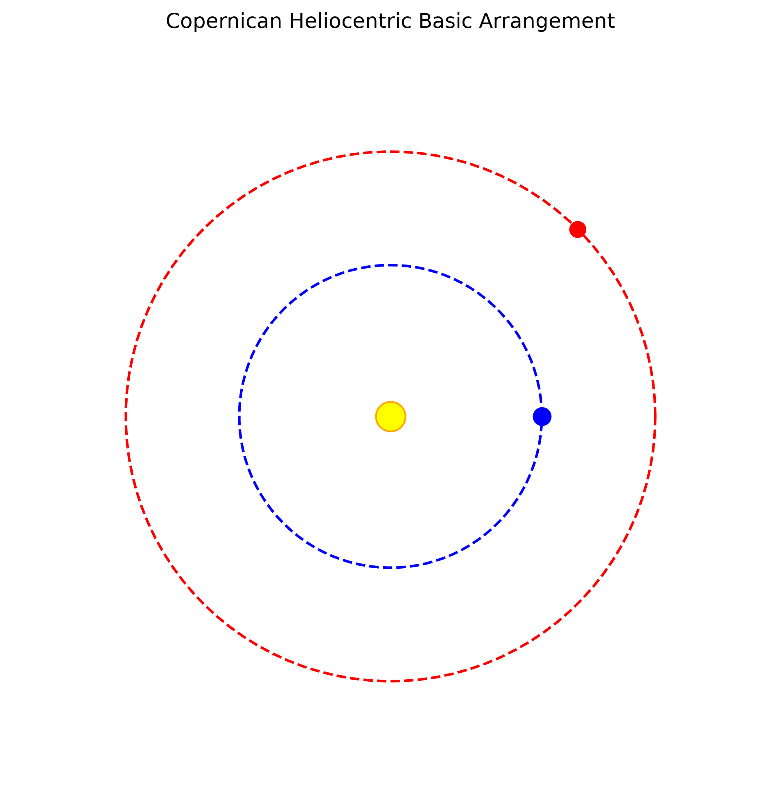
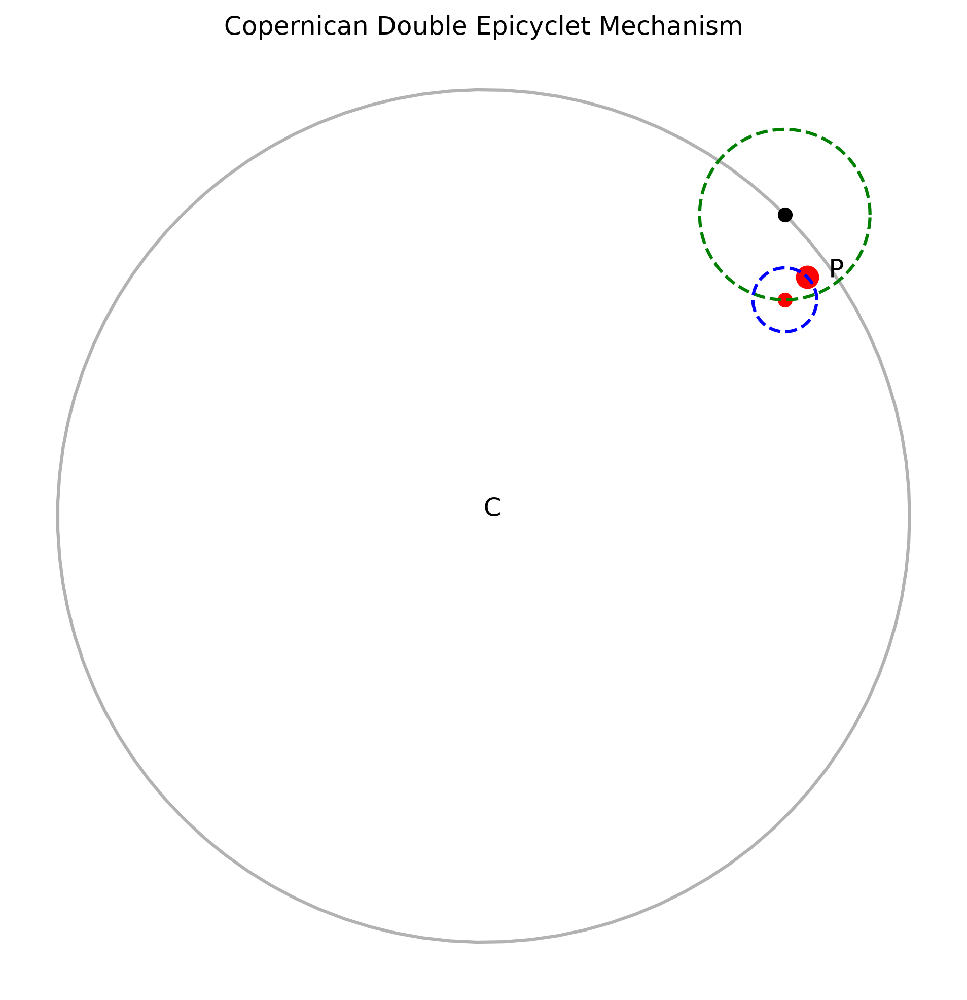
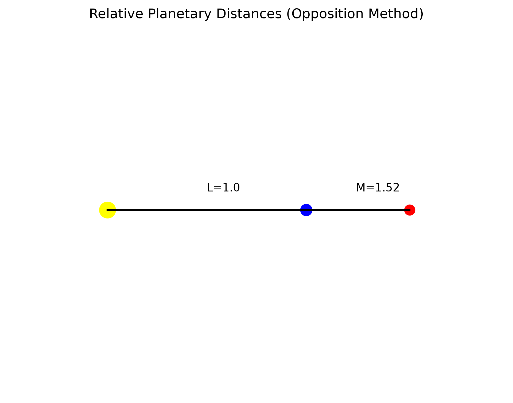

# De revolutionibus orbium coelestium libri VI (Six Books on the Revolutions of the Heavenly Spheres)

* **المؤلف:** Nicolaus Copernicus (1473–1543) | **التاريخ:** 1543-03
* **جهة النشر:** Nuremberg: Johannes Petreius, 1543 (fol.)
* **ملخص الإسهام:** Formulated heliocentric planetary kinematics; replaced Ptolemaic equant with double epicyclets and the Tusi couple to preserve uniform circular components; established orbital radii proportional to period.
* **الأثر التاريخي:** Solved the equant non-uniformity bottleneck of Ptolemy's Almagest; enabled Reinhold (B1-004) to compute Copernican tables and Kepler (B1-028) to seek physical solar causes.
* **الرابط الأرشيفي:** <https://mdz-nbn-resolving.de/urn:nbn:de:bvb:12-bsb10140939-0>

---

### هوية العمل وسياقه التاريخي

يُعرف هذا العمل التأسيسي بعنوان "عن ثورات الأجرام السماوية في ستة كتب" (De revolutionibus orbium coelestium libri VI)، وقد نُشر في نورمبرغ عام 1543. قبل هذا التاريخ، كان النظام السائد هو نظام بطليموس الذي يضع الأرض مركزاً للكون. واجه الفلكيون مشكلة فيزيائية ورياضية كبرى في "المجسطي" لبطليموس، وهي "نقطة التعادل" (Equant). كانت هذه النقطة فرضية رياضية تجعل الكوكب يبدو وكأنه يتحرك بسرعة زاوية منتظمة حول نقطة ليست هي مركز المدار الدائري، وهو ما اعتبره كوبرنيكوس انتهاكاً لمبدأ الحركة الدائرية المنتظمة المقدسة في الفيزياء الأرسطية. قدم كوبرنيكوس حلاً جذرياً بنقل مركز الكون إلى الشمس (Heliocentrism)، واستبدل نقطة التعادل بنظام من الدوائر الصغيرة الإضافية (Epicyclets) لاستعادة الانتظام الهندسي، مما سمح لأول مرة بحساب أبعاد المدارات كنسبة مباشرة من المسافة بين الأرض والشمس.

### صوت المؤلف

يقول كوبرنيكوس في الكتاب الأول، الفصل العاشر: "في وسط الجميع يجلس العرش الملكي للشمس. فمن ذا الذي يضع هذا المصباح في هذا المعبد البديع في مكان آخر غير المكان الذي يستطيع منه أن يضيء الكل في وقت واحد؟".

### الفروض والأسس التي انطلق منها المؤلف

بنى كوبرنيكوس نموذجه على فرضيات هندسية صارمة:
1. لا يوجد مركز واحد لجميع الدوائر السماوية أو الأفلاك.
2. مركز الأرض ليس مركز الكون، بل هو فقط مركز الجاذبية ومركز مدار القمر.
3. جميع الأفلاك تدور حول الشمس كما لو كانت في منتصفها تماماً، وبالتالي فإن الشمس هي مركز العالم.
4. الحركة التراجعية (Retrograde motion) التي نراها في الكواكب ليست حركة حقيقية للكوكب نفسه، بل هي وهم بصري ناتج عن حركة الأرض الراصدة.

### البرهان خطوة بخطوة بأدوات عصر المؤلف

للتخلص من "نقطة التعادل" البطلمية مع الحفاظ على دقة الأرصاد، استخدم كوبرنيكوس هندسة "مزدوجة تدوير المركز" (Double epicyclet). لنرسم المسار كما صوره كوبرنيكوس:

1. نفترض دائرة كبيرة تسمى "الفلك الحامل" (Deferent) نصف قطرها $R$ ومركزها $C$. هذا المركز $C$ لا يقع على الشمس مباشرة بل ينزاح عنها قليلاً لتمكين حساب التغير في السرعات.
2. بدلاً من وضع الكوكب على محيط الدائرة الكبيرة، نضع مركز دائرة صغيرة أولى (First Epicycle) نصف قطرها $r_1$ على محيط الدائرة الكبيرة.
3. ثم نضع دائرة صغيرة ثانية (Second Epicycle) نصف قطرها $r_2$ على محيط الدائرة الأولى. الكوكب $P$ يقع على محيط هذه الدائرة الثانية.
4. لكي نحاكي حركة نقطة التعادل القديمة، يجب أن تكون الزاوية $\alpha$ التي يقطعها مركز الدائرة الأولى مساوية للزاوية التي يقطعها الكوكب في الدائرة الثانية ولكن في اتجاهين متعاكسين وبنسب محددة.
5. من خلال تشابه المثلثات والنسب بين الأوتار (Chords)، أثبت كوبرنيكوس أن محصلة هذه الحركات الدائرية المنتظمة تنتج مساراً يكافئ في نتائجه الرياضية "نقطة التعادل" دون الحاجة لخرق مبدأ الانتظام.

### التطبيق العملي والأرقام

طبق كوبرنيكوس هذا النموذج لحساب المسافات النسبية للكواكب. إذا اعتبرنا المسافة بين الأرض والشمس وحدة فلكية واحدة، فإن كوبرنيكوس استخدم الزاوية القصوى لاستطالة الكواكب الداخلية (عطارد والزهرة) لحساب أنصاف أقطار مداراتها.

بالنسبة لكوكب خارجي مثل المريخ، رصد كوبرنيكوس الزاوية بين الشمس والكوكب كما تُرى من الأرض عند "المقابلة" (Opposition). باستخدام هندسة المثلثات، حيث $L$ هي المسافة من الشمس إلى الأرض و $M$ هي المسافة من الشمس إلى المريخ، وجد أن النسبة بينهما ثابتة وتعتمد على الزمن الدوري للكوكب.

$$ \frac{M}{L} \approx 1.52 $$

هذا الرقم الذي استنتجه كوبرنيكوس قريب جداً من القياسات الحديثة، وقد سمح له بترتيب الكواكب لأول مرة ترتيباً صحيحاً بناءً على معيار فيزيائي رياضي وليس مجرد تخمين.

### العدسة الحديثة

اليوم، نعبر عن حركة الكوكب $P$ في نموذج كوبرنيكوس باستخدام المتجهات في المستوى المركب. موضع الكوكب هو مجموع متجهات دوارة:
$$ \vec{r}(t) = R e^{i\omega_1 t} + r_1 e^{i\omega_2 t} + r_2 e^{i\omega_3 t} $$
حيث تمثل كل $e^{i\omega t}$ حركة دائرية منتظمة بتردد زاوي محدد، وهو ما نعتبره اليوم تحليلاً أولياً لسلسلة فوريه (Fourier Series) لوصف المدارات الإهليلجية باستخدام الدوائر.

### الثغرة التي لم يرها المؤلف

تمسك كوبرنيكوس بالدوائر الكاملة (Perfect Circles) كضرورة فيزيائية وجمالية، مما اضطره لاستخدام عدد كبير من التداوير (Epicycles) وصل إلى حوالي 48 دائرة لتفسير التفاوتات الطفيفة في السرعة. لم يدرك أن المدارات ليست دوائر مركبة، بل هي قطوع ناقصة (Ellipses)، وهو الاكتشاف الذي حققه يوهانس كيبلر لاحقاً بعد تحليل أرصاد تيكو براهي الدقيقة.

### السؤال المعلَّق

إذا كان كوبرنيكوس قد نجح في حل معضلة "نقطة التعادل" هندسياً واستعاد انتظام الحركة الدائرية، فما هو التفسير الفيزيائي الذي يجعل الأرض الثقيلة تتحرك والشمس تظل ثابتة، وكيف يمكننا حساب جداول فلكية دقيقة بناءً على هذا النموذج الجديد تتفوق على الجداول القديمة؟
