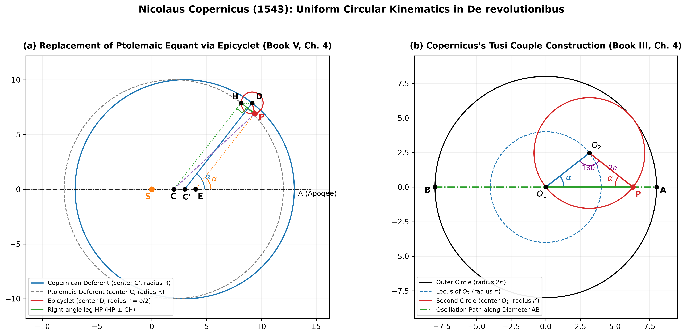

# De revolutionibus orbium coelestium libri VI (Six Books on the Revolutions of the Heavenly Spheres)

* **المؤلف:** Nicolaus Copernicus (1473–1543) | **التاريخ:** 1543-03
* **جهة النشر:** Nuremberg: Johannes Petreius, 1543 (fol.)
* **قطعة البازل:** Formulated heliocentric planetary kinematics; replaced Ptolemaic equant with double epicyclets and the Tusi couple to preserve uniform circular components; established orbital radii proportional to period.
* **الجسر السببي:** Solved the equant non-uniformity bottleneck of Ptolemy's Almagest; enabled Reinhold (B1-004) to compute Copernican tables and Kepler (B1-028) to seek physical solar causes.
* **الرابط الأرشيفي:** <https://mdz-nbn-resolving.de/urn:nbn:de:bvb:12-bsb10140939-0>

---

**عنوان العمل بالإنجليزية:** \textenglish{Six Books on the Revolutions of the Heavenly Spheres}
**عنوان العمل بالعربية:** ستة كتب في دورات الأفلاك السماوية

## 1. بطاقة العنوان والهوية
- **الرمز الأرشيفي:** B1-001
- **المؤلف:** نيكولاوس كوبرنيكوس (1473–1543)
- **تاريخ النشر:** مارس 1543
- **جهة النشر والأرشيف:** نورمبرغ، مطبعة يوهانس بيتريوس، 1543 (طبعة قطع كامل)
- **التصنيف التاريخي والمنهجي:** كينماتيكا سماوية هندسية، استبدال مركزية الأرض بمركزية الشمس (Heliocentric Kinematics)، وإعادة صياغة حركات الكواكب عبر الدوائر المنتظمة الخالصة.
- **الموقع في سلسلة البازل العلمية:** قدّم هذا العمل البنية الكينماتيكية المركزية الشمسية الأولى القادرة على الحساب الفلكي الكمي، وحلّ المعضلة الفلسفية والرياضية لعدم انتظام الحركة في نقطة معدل المسير (Equant) عند بطليموس عبر تراكب فلك التدوير الصغير (Epicyclet) ومزدوجة الطوسي (Tusi Couple)، كما أرسى العلاقة الحتمية بين أنصاف أقطار المدارات وأزمنتها الدورية؛ وهو ما مكّن راينهولد لاحقاً من حساب الجداول الفلكية البروسية، ومهّد الطريق لكبلر للبحث في العلل الفيزيائية الشمسية للحركة.

---

## 2. التأصيل التاريخي المنهجي للفكرة
واجه علم الفلك الرياضي منذ العصور القديمة تحدياً مزدوجاً يُعرف بمشكلة «إنقاذ الظواهر» (Saving the Phenomena): كيف نفسر التغيرات الظاهرية في سرعة الكواكب، وحركاتها التراجعية (Retrograde Motion)، وتفاوت لمعانها، مع الالتزام الصارم بالمبدأ الفيزيائي الأرسطي والأفلاطوني القائل إن الأجرام السماوية الأثيرية لا تتحرك إلا حركات دائرية منتظمة السرعة الزاوية حول مراكز أفلاكها؟

في القرن الثاني الميلادي، بنى بطليموس نظامه الهندسي المتمحور حول الأرض، غير أنه اضطر في كتابه «المجسطي» إلى إدخال حيلة رياضية عُرفت بنقطة «معدل المسير» (Equant Point)؛ حيث جعل مركز الفلك الحامل (Deferent) منزاحاً عن الأرض بمقدار اللامركزية $e$، بينما جعل الحركة الزاوية المنتظمة لمركز التدوير لا تُقاس حول مركز الفلك نفسه، بل حول نقطة أخرى تقع على بُعد $2e$ من الأرض. حقق هذا الحل دقة رصدية ملحوظة، لكنه نسف المبدأ الأساسي للحركة الدائرية المنتظمة؛ إذ يقتضي أن يدور الفلك المادي حول مركزه بسرعة زاوية متغيرة تزداد عند الحضيض وتنقص عند الأوج، وهو ما عُدّ تناقضاً ميكانيكياً وكونياً مستحيلاً في الأجسام الصلبة السماوية.

في القرن السادس عشر، انطلق كوبرنيكوس من هذا التناقض ذاته باعتباره الدافع الجوهري لثورته. لم يكن كوبرنيكوس يمتلك مفهوم القوة الجاذبة أو التفاضل أو المدارات الإهليلجية؛ بل عمل بعقلية المهندس الكلاسيكي الذي يستلهم إقليدس وبطليموس والفلكيين الشرقيين (مثل نصير الدين الطوسي وابن الشاطر). أدرك كوبرنيكوس أن إحلال الشمس المتوسطة في مركز المنظومة ونقل الأرض إلى فلك سنوي يدور حولها يُلغي تلقائياً دوائر التدوير الكبرى التي استخدمها بطليموس لتفسير الحركة التراجعية، ويكشف عن تناغم هندسي مذهل يربط أبعاد الأفلاك بأزمنة دوراتها. والأهم من ذلك، استبدل كوبرنيكوس نقطة معدل المسير المرفوضة بتراكب دوائر تدوير صغرى ومزدوجة الطوسي، مُبرهناً بالهندسة الإقليدية وجداول الجيوب (نصف الوتر) على أن اجتماع حركتين دائريتين منتظمتين تماماً يعطي المسار والموضع نفسيهما اللذين يعطيهما معدل المسير البطلمي تقريباً.

---

## 3. التعريفات الرسمية ودليل الرموز (Formal Definitions & Symbol Guide)
يعرض كوبرنيكوس بناءه الهندسي معتمداً على الدوائر، والأوتار، والجيوب (التي تمثل نصف وتر ضعف القوس في دائرة نصف قطرها القياسي $10,000$ جزء أو $100,000$ جزء). وفي ما يلي التعريفات الرسمية للرموز المستخدمة في البراهين الثلاثة الجوهرية للعمل:

| الرمز | الدلالة الهندسية والفيزيائية |
| :--- | :--- |
| $S$ | مركز الشمس المتوسطة والمرجع الساكن لمنظومة الأفلاك (Mean Sun) |
| $A$ | نقطة الأوج على خط الأوج والحضيض، وهي أبعد موضع عن المركز $S$ |
| $C$ | مركز الفلك الحامل في النموذج البطلمي على خط $SA$ |
| $C'$ | مركز الفلك الحامل في النموذج الكوبرنيكي على خط $SA$ |
| $E$ | نقطة معدل المسير البطلمية المرفوضة كوبرنيكياً |
| $R$ | نصف قطر الفلك الحامل المداري للكوكب أو للأرض |
| $e$ | مقدار اللامركزية بين الشمس المتوسطة $S$ والمركز البطلمي $C$ |
| $r$ | نصف قطر فلك التدوير الصغير، ويساوي نصف اللامركزية $e$ |
| $D$ | مركز فلك التدوير الصغير المتحرك بانتظام على محيط الفلك الكوبرنيكي |
| $P$ | الموضع الهندسي الفعلي للكوكب على محيط فلك التدوير الصغير |
| $H$ | نقطة مساعدة على الفلك البطلمي تُكوّن متوازي أضلاع مع $C$ و$C'$ و$D$ |
| $\alpha$ | زاوية الشذوذ المتوسط المقاسة بانتظام من خط الأوج $SA$ |
| $\delta$ | زاوية التفاوت بين اتجاه الكوكب من المركز $C$ والاتجاه المتوسط $\alpha$ |
| $O_1, O_2$ | مركزا الدائرتين المتساويتين في مزدوجة الطوسي المولدة للحركة المستقيمة |
| $T$ | موضع الأرض المتحركة على الفلك العظيم حول الشمس $S$ |
| $R_E, R_P$ | نصف قطر الفلك العظيم للأرض ونصف قطر فلك الكوكب على الترتيب |
| $T_E, T_P$ | الزمن الدوري النجمي للأرض وللكوكب الخارجي مقاساً بالأيام |
| $S_{\text{syn}}$ | الزمن الاقتراني المتوسط بين تقابلين متتاليين للكوكب |
| $\omega_E, \omega_P, \omega_{\text{syn}}$ | السرعات الزاوية اليومية بالدرجات للأرض وللكوكب وللاقتران |
| $\eta$ | زاوية الاستطالة المرصودة بين الشمس والكوكب من الأرض $T$ |
| $\Delta\lambda$ | الزاوية المركزية الشمسية الفاصلة بين الأرض والكوكب بعد التقابل |

---

## 4. تحليل الفرضيات والبديهيات (Axioms & Postulates)
يبني كوبرنيكوس في الكتاب الأول من مؤلفه نسقاً من البديهيات الهندسية والطبيعية الصارمة التي تحكم برهانه:

1. **كروية العالم والأجرام السماوية:** الفضاء الكوني كروي الشكل لأن الكرة أكمل الأشكال الهندسية وأوسعها حجماً بالنسبة لسطحها، وكذلك الأجرام السماوية كروية لأن أجزاءها تتجمع بتساوي الأبعاد حول مراكزها.
2. **أزلية الحركة الدائرية المنتظمة:** حركة الأجرام السماوية دائرية منتظمة السرعة الزاوية حول مراكز أفلاكها الخاصة، أو مركبة من حركات دائرية منتظمة؛ لأن كل تباطؤ أو تسارع ظاهر في حركة جرم سماوي حول مركزه الذاتي لا يمكن أن ينشأ إلا من تفاوت في البُعد عن الراصد أو من تراكب دوائر متعددة تدور بانتظام تام.
3. **حركة الأرض المثلثة:** الأرض كوكب كروي ليست ساكنة في وسط الكون، بل تؤدي ثلاث حركات دائرية منتظمة متزامنة: دوران يومي حول محورها من الغرب إلى الشرق (يفسر تعاقب الليل والنهار وشروق النجوم وغروبها)، ودوران سنوي في الفلك العظيم حول الشمس المتوسطة $S$ (يفسر الفصول والحركات التراجعية للكواكب)، وحركة مخروطية بطيئة لمحورها تحافظ على ثبات ميله وتفسر مبادرة الاعتدالين.
4. **شساعة فلك النجوم الثابتة:** البُعد بين الشمس والأرض ($R_E$) ضئيل جداً مقارنة بنصف قطر فلك النجوم الثابتة، بحيث يبدو الفلك العظيم للأرض كنقطة غير محسوسة بالنسبة لسماء الثوابت، فلا يظهر اختلاف منظر (Parallax) سنوي للنجوم.
5. **نسبية الرصد الهندسي:** كل تغير موضعي يُرصد في السماء يعود إما إلى حركة الجرم المرصود، وإما إلى حركة الراصد على الأرض، وإما إلى اختلاف حركتيهما؛ وبالتالي فإن الحلقات التراجعية الظاهرية للكواكب الخمسة ليست حركات حقيقية في مداراتها، بل هي انعكاس هندسي لحركة الأرض السنوية حول الشمس.

---

## 5. البرهنة الكاملة خطوة بخطوة بأدوات المؤلف الأصلية مع الوصف التخيلي للشكل

نقدم هنا البراهين الهندسية الثلاثة التي تشكل العمود الفقري لكتاب كوبرنيكوس، ملتزمين التزاماً حرفياً بالهندسة الإقليدية وجداول الجيوب ونسب الأوتار كما استعملها المؤلف في منتصف القرن السادس عشر.

### أولاً: برهان استبدال معدل المسير البطلمي بفلك التدوير الصغير (الكتاب الخامس، الفصل الرابع)

**الوصف الهندسي التخيلي للشكل:**
تخيل خطاً مستقيماً أفقياً يبدأ من الشمس المتوسطة $S$ ويتجه يميناً نحو نقطة الأوج $A$. على هذا الخط، نعيّن ثلاث نقاط متتالية: أولها المركز البطلمي $C$ على بُعد $SC = e$، وثانيها المركز الكوبرنيكي $C'$ على بُعد $SC' = \frac{3}{2}e$، وثالثها نقطة معدل المسير البطلمية $E$ على بُعد $SE = 2e$. نلاحظ فوراً أن $C'$ ينصّف القطعة المستقيمة $CE$ تماماً، بحيث يكون $CC' = C'E = \frac{1}{2}e$.
الآن ارسم دائرة الفلك الحامل الكوبرنيكي مركزها $C'$ ونصف قطرها $R$. يتحرك مركز فلك التدوير الصغير $D$ على محيط هذه الدائرة عكس عقارب الساعة بحيث يصنع الشعاع $C'D$ مع خط الأوج $C'A$ زاوية منتظمة النمو $\alpha$. وحول النقطة $D$، ارسم دائرة صغيرة (فلك التدوير الصغير) نصف قطرها $r = \frac{1}{2}e$. يبدأ الكوكب $P$ حركته عند $\alpha = 0$ من النقطة الأقرب إلى $C'$ على محيط الفلك الصغير (حضيض التدوير)، ثم يدور الكوكب $P$ حول $D$ في الاتجاه نفسه (عكس عقارب الساعة) وبمعدل زاوي مساوٍ لـ $\alpha$ بالنسبة لنصف القطر الداخلي الواصل نحو $C'$.

**خطوات البرهان الإقليدي:**
1. **تحديد اتجاه نصف قطر التدوير $DP$:**
   عندما ينتقل المركز $D$ بزاوية $\alpha$ عن خط الأوج $C'A$، فإن امتداد نصف القطر نحو الداخل (نحو $C'$) يكون مائلاً بزاوية $180^\circ + \alpha$ عن الاتجاه $SA$. وبما أن الكوكب $P$ قد دار من هذا الخط الداخلي بالزاوية $\alpha$ نفسها في الاتجاه الموجب عينه، فإن الزاوية الكلية للقطعة $DP$ مقاسةً من خط الأوج $SA$ تصبح مساويةً لـ $180^\circ + 2\alpha$.
2. **بناء متوازي الأضلاع المساعد $CC'DH$:**
   من المركز البطلمي $C$، ارسم قطعة مستقيمة $CH$ مساويةً وموازيةً لـ $C'D$؛ فيكون طول $CH = R$، وتكون الزاوية $\angle ACH = \alpha$، وتقع النقطة $H$ بالضرورة على محيط الفلك الحامل البطلمي ذي المركز $C$. وبحسب القضية (33) من المقالة الأولى لإقليدس، بما أن $CH$ تساوي وتوازي $C'D$، فإن الشكل $CC'DH$ متوازي أضلاع، ومن ثم فإن الضلع $HD$ يساوي ويوازي $CC'$.
3. **إثبات أن المثلث $DHP$ متساوي الساقين:**
   بما أن $HD$ يوازي $CC'$ ويتجه نحو $A$ (بزاوية $0^\circ$) وطوله $\frac{1}{2}e$، فإن الشعاع المعكوس $DH$ يتجه نحو $S$ (بزاوية $180^\circ$). وبما أن الشعاع $DP$ يتجه بزاوية $180^\circ + 2\alpha$ وطوله $r = \frac{1}{2}e$، نجد في المثلث $DHP$ أن:
   $$DH = DP = \frac{1}{2}e$$
   كما أن الزاوية المحصورة بين الضلعين عند الرأس $D$ هي:
   $$\angle HDP = (180^\circ + 2\alpha) - 180^\circ = 2\alpha$$
   وبما أن المثلث $DHP$ متساوي الساقين، فإن زاويتي القاعدة متساويتان:
   $$\angle DHP = \angle DPH = \frac{180^\circ - 2\alpha}{2} = 90^\circ - \alpha$$
4. **حساب طول القاعدة $HP$ وإثبات التعامد ($\angle CHP = 90^\circ$):**
   من هندسة الأوتار في دائرة نصف قطرها $r = \frac{1}{2}e$، يكون طول الوتر المقابل للزاوية المركزية $2\alpha$ مساوياً لضعف جيب نصف الزاوية مضروباً في نصف القطر:
   $$HP = 2 \left(\frac{1}{2}e\right) \sin\alpha = e \sin\alpha$$
   والآن لنتأمل الزاوية $\angle CHP$ عند النقطة $H$: إن اتجاه $HC$ يميل بزاوية $180^\circ + \alpha$، بينما يتجه $HD$ بزاوية $0^\circ$ (أي $360^\circ$)، فتكون الزاوية $\angle CHD = 180^\circ - \alpha$. وحيث إن الضلع $HP$ يقع على الجانب الآخر من $HD$ مبتعداً بمقدار $\angle DHP = 90^\circ - \alpha$ في الاتجاه المقابل (أي بزاوية كلية $\alpha - 90^\circ$)، فإن الزاوية المحصورة بين $CH$ (الذي زاويته $\alpha$) و$HP$ (الذي زاويته $\alpha - 90^\circ$) هي زاوية قائمة تماماً في كل موضع من المدار:
   $$\angle CHP = 90^\circ$$
5. **المقارنة المباشرة مع معدل المسير البطلمي:**
   في المثلث القائم $\triangle CHP$، الضلعان القائمان هما $CH = R$ و$HP = e \sin\alpha$. وبتطبيق مبرهنة فيثاغورس (المقالة الأولى من إقليدس، القضية 47)، يكون البعد $CP$ هو:
   $$CP = \sqrt{R^2 + e^2 \sin^2\alpha}$$
   وحيث إن اللامركزية $e$ صغيرة مقارنة بنصف القطر $R$، فإن $CP$ يطابق $R$ بدرجة عالية جداً (على سبيل المثال، حتى في كوكب المريخ ذي اللامركزية الكبيرة نسبياً، لا يتجاوز الفارق أربعة أجزاء من الألف). أما زاوية الانحراف $\delta = \angle HCP$ فتُعطى من المثلث القائم بالعلاقة المثلثية:
   $$\frac{HP}{CP} = \sin\delta \implies \sin\delta = \frac{e \sin\alpha}{\sqrt{R^2 + e^2 \sin^2\alpha}} \approx \frac{e}{R} \sin\alpha$$
   وبالتالي، فإن الزاوية التي يصنعها الكوكب حول المركز $C$ هي:
   $$\angle ACP = \alpha - \delta$$
   أما في نموذج بطليموس، فإذا رمزنا إلى موضع الكوكب بـ $P_{\text{Ptol}}$ على الدائرة $(C, R)$ بحيث تكون زاوية معدل المسير $\angle AEP_{\text{Ptol}} = \alpha$، فبتطبيق قانون الجيوب في المثلث $\triangle ECP_{\text{Ptol}}$ (حيث $CE = e$ و$CP_{\text{Ptol}} = R$ والزاوية عند $E$ هي $180^\circ - \alpha$) نجد:
   $$\frac{\sin(\angle EP_{\text{Ptol}}C)}{e} = \frac{\sin\alpha}{R} \implies \sin(\angle EP_{\text{Ptol}}C) = \frac{e}{R} \sin\alpha$$
   ومن الزاوية الخارجة $\alpha = \angle ACP_{\text{Ptol}} + \angle EP_{\text{Ptol}}C$، نستنتج أن $\angle ACP_{\text{Ptol}} = \alpha - \angle EP_{\text{Ptol}}C$. وهكذا يثبت كوبرنيكوس أن تراكب الحركتين الدائريتين المنتظمتين تماماً حول $C'$ و$D$ يطابق زوايا معدل المسير البطلمي تطابقاً رصدياً دقيقاً دون أي انتهاك لمبدأ انتظام الدوران!

---

### ثانياً: برهان مزدوجة الطوسي لتوليد الحركة المستقيمة من دائرتين منتظمتين (الكتاب الثالث، الفصل الرابع)

استخدم كوبرنيكوس هذه الآلية الهندسية لتفسير التغيرات الترددية في ميل محور الأرض ومبادرة الاعتدالين، كما أوضح بها كيفية تغيير اللامركزية دون كسر الحركة الدائرية المنتظمة.

**الوصف الهندسي التخيلي للشكل:**
ارسم دائرة كبرى ثابتة مركزها $O_1$ وقطرها المستقيم الأفقي $AB$، وليكن طول نصف قطرها $O_1A = 2r'$. داخل هذه الدائرة، ارسم دائرةً وسطى مركزها $O_1$ ونصف قطرها $r'$؛ يتحرك على محيط هذه الدائرة الوسطى مركز دائرة ثانية $O_2$ بحيث يميل الشعاع $O_1O_2$ بزاوية $\alpha$ عن القطر $O_1A$. حول $O_2$، ارسم دائرة نصف قطرها مساوٍ تماماً لـ $r'$ (فهي تمر حتماً بالمركز $O_1$ وتماس الدائرة الكبرى من الداخل). يتحرك الجرم $P$ على محيط الدائرة الثانية بدءاً من $A$ (عند $\alpha = 0$) في الاتجاه المعاكس لحركة $O_2$ بضعف السرعة الزاوية (أي بزاوية $2\alpha$ مقاسة من امتداد $O_1O_2$، فتكون الزاوية الداخلية $\angle O_1O_2P = 180^\circ - 2\alpha$).

**خطوات البرهان الإقليدي:**
1. في المثلث $O_1O_2P$، يتساوى الضلعان $O_1O_2 = r'$ و$O_2P = r'$ لأنهما أنصاف أقطار متساوية.
2. بما أن المثلث $O_1O_2P$ متساوي الساقين، فإن زاويتي القاعدة متساويتان: $\angle O_2O_1P = \angle O_2PO_1$.
3. مجموع زوايا المثلث $180^\circ$، وبما أن زاوية الرأس هي $\angle O_1O_2P = 180^\circ - 2\alpha$، فإن مجموع زاويتي القاعدة يساوي $2\alpha$، ومن ثم:
   $$\angle O_2O_1P = \alpha$$
4. وحيث إن الزاوية $\angle AO_1O_2 = \alpha$ أيضاً وفي الاتجاه نفسه للانفراج عن $O_1O_2$، فإن الشعاع $O_1P$ ينطبق تماماً على القطر الثابت $O_1A$ في كل لحظة!
5. لحساب بُعد النقطة $P$ عن المركز $O_1$، نسقط عموداً من $O_2$ على $O_1P$ (وهو القطر $AB$) في المثلث المتساوي الساقين، فينصّف القاعدة $O_1P$، ويعطي فوراً:
   $$O_1P = 2 r' \cos\alpha$$
   أي أن النقطة $P$ تتذبذب ذهاباً وإياباً على طول القطر المستقيم $AB$ كله بحركة ترددية مستقيمة خالصة ناجمة عن حركتين دائريتين منتظمتين تماماً!

---

### ثالثاً: برهان حساب أنصاف أقطار الأفلاك الكوكبية وتناسبها مع الأزمنة الدورية (الكتاب الأول والكتاب الخامس)

**الوصف الهندسي التخيلي للشكل:**
ليكن $S$ مركز الشمس، ولتدر الأرض $T$ في فلكها العظيم بنصف قطر $R_E = ST = 10,000$ جزء، وليدر كوكب خارجي $P$ (مثل المريخ) في فلك أوسع بنصف قطر $R_P = SP$. عند لحظة التقابل (Opposition)، تكون النقاط $S$ و$T$ و$P$ على استقامة واحدة. بعد مرور عدد معلوم من الأيام $\Delta t$، تقطع الأرض زاوية أسرع من الكوكب فتتقدمه بزاوية مركزية شمسية $\Delta\lambda = \angle TSP$.

**خطوات البرهان:**
1. **إيجاد الزمن الدوري النجمي $T_P$:**
   بما أن الأرض أسرع زاويةً من الكوكب الخارجي، فإن السرعة الزاوية الظاهرية للاقتران (أو التقابل) هي الفرق بين السرعتين اليوميتين:
   $$\omega_{\text{syn}} = \omega_E - \omega_P \implies \frac{360^\circ}{S_{\text{syn}}} = \frac{360^\circ}{T_E} - \frac{360^\circ}{T_P}$$
   وبقسمة الطرفين على $360^\circ$ نحصل على العلاقة الكوبرنيكية للفترات:
   $$\frac{1}{T_P} = \frac{1}{T_E} - \frac{1}{S_{\text{syn}}}$$
2. **حساب نصف قطر المدار $R_P$ عند التربيع أو الاستطالة المعلومة:**
   عند الزمن $\Delta t$ بعد التقابل، تكون الزاوية الشمسية بين الأرض والكوكب هي $\Delta\lambda = \omega_{\text{syn}} \Delta t$. ويرصد الفلكي من الأرض $T$ زاوية الاستطالة بين الشمس والكوكب $\eta = \angle STP$. في المثلث $\triangle STP$، تكون زاوية اختلاف المنظر (Parallax of the Great Orb) عند الكوكب هي:
   $$\angle SPT = 180^\circ - (\Delta\lambda + \eta)$$
   وبتطبيق قانون الجيوب (الذي برهن عليه كوبرنيكوس بالأوتار في الكتاب الأول، الفصل الثالث عشر) على المثلث $\triangle STP$:
   $$\frac{SP}{\sin(\angle STP)} = \frac{ST}{\sin(\angle SPT)}$$
   ومنه نستخرج نصف قطر فلك الكوكب بدلالة نصف قطر فلك الأرض:
   $$R_P = R_E \frac{\sin\eta}{\sin(\Delta\lambda + \eta)}$$
   وفي الحالة الخاصة عند التربيع ($\eta = 90^\circ$) يصبح المثلث $\triangle STP$ قائم الزاوية في $T$، فتختصر المعادلة إلى:
   $$R_P = \frac{R_E}{\cos(\Delta\lambda)}$$
   وبالنسبة للكواكب الداخلية (عطارد والزهرة) الواقعة داخل الفلك العظيم للأرض، عند أقصى استطالة $\varepsilon_{\max}$ يكون خط البصر $TP$ مماساً لمدار الكوكب (قضية إقليدس: المماس عمودي على نصف القطر عند نقطة التماس $\angle SPT = 90^\circ$)، فيُعطى نصف القطر مباشرة بالمعادلة:
   $$R_P = R_E \sin(\varepsilon_{\max})$$
   وهكذا برهن كوبرنيكوس رياضياً ولأول مرة على ترتيبٍ مكانيٍّ حتميٍّ متناغم للأفلاك تزداد فيه أنصاف الأقطار باطّراد مع ازدياد الأزمنة الدورية من عطارد إلى زحل.

---

## 6. التمثيل والتطبيق العملي

نطبّق الآن المعادلات الكوبرنيكية السابقة رقمياً على **كوكب المريخ**، وهو الكوكب الذي شكّل الاختبار الأعظم لنظرية الكواكب في القرن السادس عشر:

### 1. حساب الزمن الدوري ونصف قطر مدار المريخ بوحدات الفلك العظيم:
- الزمن الدوري النجمي للأرض: $T_E = 365.25$ يوماً، فتكون سرعتها الزاوية اليومية $\omega_E = \frac{360^\circ}{365.25} = 0.9856^\circ$ في اليوم.
- الزمن الاقتراني المتوسط المرصود للمريخ: $S_{\text{syn}} = 779.94$ يوماً، فتكون سرعة الاقتران $\omega_{\text{syn}} = \frac{360^\circ}{779.94} = 0.4616^\circ$ في اليوم.
- نستنتج السرعة الزاوية النجمية للمريخ:
  $$\omega_M = 0.9856^\circ - 0.4616^\circ = 0.5240^\circ$$
  في اليوم، ومنها يبلغ زمنه الدوري النجمي:
  $$T_M = \frac{360^\circ}{0.5240^\circ} \approx 687 \text{ يوماً}$$
- برصد المريخ عند وضع التربيع ($\eta = 90^\circ$) بعد مرور $\Delta t = 106.1$ يوماً من التقابل، تبلغ الزاوية المركزية الفاصلة:
  $$\Delta\lambda = 0.4616^\circ \times 106.1 = 48.98^\circ$$
- بتطبيق علاقة المثلث القائم (باعتبار $R_E = 10,000$ جزء):
  $$R_M = \frac{10,000}{\cos(48.98^\circ)} = \frac{10,000}{0.6563} \approx 15,237 \text{ جزءاً}$$
  وهو ما يطابق القيمة المعتمدة عند كوبرنيكوس ($15,200$ جزء، أي نحو $1.52$ ضعف نصف قطر مدار الأرض).

### 2. اختبار دقة فلك التدوير الصغير مقابل معدل المسير للمريخ:
في المدار الحقيقي للمريخ، تبلغ اللامركزية البطلمية نصف الكلية $e \approx 0.10 \, R_M$ (أي $1,520$ جزءاً). يضع كوبرنيكوس مركز الفلك الحامل $C'$ على بُعد $\frac{3}{2}e = 0.15 \, R_M$، ونصف قطر فلك التدوير الصغير $r = \frac{1}{2}e = 0.05 \, R_M$. لنختبر الموضع عند الشذوذ المتوسط $\alpha = 60^\circ$:
- في المثلث القائم الكوبرنيكي $\triangle CHP$:
  $$HP = e \sin 60^\circ = 0.10 \, R_M \times 0.8660 = 0.08660 \, R_M$$
  ويكون البعد عن $C$:
  $$CP = R_M \sqrt{1 + (0.08660)^2} = 1.00374 \, R_M$$
  (انحراف نصفي قطري لا يتعدى $0.37\%$ فقط).
- وتكون زاوية الانحراف الكوبرنيكية $\delta$:
  $$\sin\delta = \frac{0.08660}{1.00374} = 0.08628 \implies \delta \approx 4.95^\circ$$
  أي أن الموضع الزاوي حول $C$ هو $\angle ACP = 60^\circ - 4.95^\circ = 55.05^\circ$.
- بالمقارنة مع معدل المسير البطلمي عند $\alpha = 60^\circ$:
  $$\sin(\angle EP_{\text{Ptol}}C) = 0.10 \sin 60^\circ = 0.08660 \implies \angle EP_{\text{Ptol}}C \approx 4.97^\circ$$
  أي أن الموضع الزاوي البطلمي هو $60^\circ - 4.97^\circ = 55.03^\circ$.
- لا يتجاوز الفارق بين النموذجين $0.02^\circ$ (نحو دقيقة قوسية واحدة)، وهو فارق غير قابل للتمييز تماماً بأدوات الرصد بالعين المجردة في عام 1543، مع تحقيق المكسب النظري الأعظم: تطهير السماء من الحركة غير المنتظمة.
