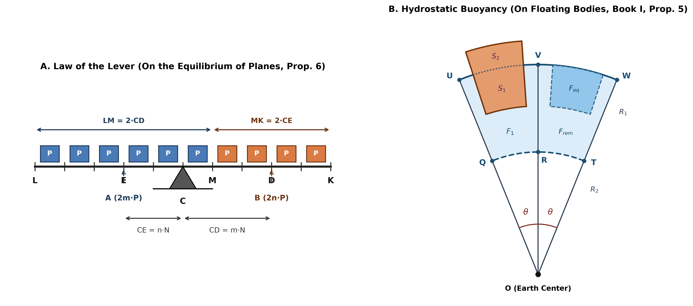

# Archimedis Syracusani philosophi ac geometrae excellentissimi Opera, quae quidem extant, omnia (Extant Works of Archimedes: Equilibrium of Planes, Floating Bodies, Quadrature of the Parabola)

* **المؤلف:** Archimedes of Syracuse (c. 287–c. 212 BCE), ed. Thomas Venatorius (1488–1551) | **التاريخ:** 1544
* **جهة النشر:** Basel: Johannes Hervagius, 1544 (editio princeps Greek & Latin)
* **قطعة البازل:** Restored rigorous Euclidean deduction to statics (law of the lever, center of gravity of plane figures) and hydrostatics (buoyancy principle: upward force = weight of displaced fluid).
* **الجسر السببي:** Solved the qualitative Aristotelian dynamics bottleneck of Scholastic physics; directly provided the mathematical foundation for Tartaglia (B1-003), Benedetti (B1-005), Commandino (B1-007), and Stevin (B1-016).
* **الرابط الأرشيفي:** <https://doi.org/10.3931/e-rara-9130>

---

**عنوان العمل بالإنجليزية:** \textenglish{(The Complete Extant Works of Archimedes of Syracuse, Most Excellent Philosopher and Geometer: Equilibrium of Planes, Floating Bodies, Quadrature of the Parabola)}
**عنوان العمل بالعربية:** الأعمال الكاملة الباقية لأرخميدس السرقوسي، الفيلسوف والمهندس الجليل: في توازن السطوح المستوية، والأجسام الطافية، وتربيع القطع المكافئ

## 1. **بطاقة العنوان والهوية**

- **الرمز الأرشيفي:** \textenglish{(B1-002)}
- **المؤلف والمحرر:** أرخميدس السرقوسي \textenglish{(Archimedes of Syracuse, c. 287--c. 212 BCE)}، بتحرير توماس فيناتوريوس \textenglish{(Thomas Venatorius, 1488--1551)}.
- **سنة النشر ومكانه:** \textenglish{(1544)}، مدينة بازل \textenglish{(Basel)}، مطبعة يوهانس هيرفاغيوس \textenglish{(Johannes Hervagius)}، بوصفها الطبعة المطبوعة الأولى \textenglish{(Editio Princeps)}.
- **الموضوعات المحورية في العمل:** تأسيس علم السكون \textenglish{(Statics)} عبر قانون الرافعة ومراكز الثقل للأشكال المستوية، وتأسيس علم سكون الموائع \textenglish{(Hydrostatics)} عبر مبدأ الطفو والانغمار، وتكامل المساحات المنحنية عبر تربيع القطع المكافئ \textenglish{(Quadrature of the Parabola)} بطريقة الاستنفاد \textenglish{(Method of Exhaustion)}.
- **الأثر التاريخي في فيزياء عصر النهضة:** حرر هذا العمل الفيزياء من قيود الديناميكا الأرسطية الوصفية السائدة في الفلسفة المدرسية \textenglish{(Scholasticism)}، وأعاد إليها الصرامة الاستنباطية الإقليدية، ممهداً الطريق الرياضي المباشر لأعمال تارتاليا \textenglish{(Tartaglia, B1-003)}، وبينيديتي \textenglish{(Benedetti, B1-005)}، وكوماندينو \textenglish{(Commandino, B1-007)}، وستيفين \textenglish{(Stevin, B1-016)}.

---

## 2. **التأصيل التاريخي المنهجي للفكرة**

في منتصف القرن السادس عشر، وتحديداً عند صدور طبعة بازل سنة \textenglish{(1544)}، كانت الفيزياء الأوروبية لا تزال أسيرة الفلسفة الطبيعية الأرسطية التي تفسر الحركة والتوازن تفسيراً كيفياً غائياً يعتمد على الطبائع الأربع ومفهوم الأماكن الطبيعية، دون أن تمتلك لغة كمية قادرة على استنباط المقادير الفيزيائية بالبرهان الهندسي المحض. ومع أن بعض الشذرات الميكانيكية المنسوبة إلى أرسطو أو مدرسة الميزان القروسطية \textenglish{(Scientia de Ponderibus)} كانت متداولة في المخطوطات، إلا أن نشر الأعمال الكاملة لأرخميدس مرفقةً بشروح أوطوقيوس العسقلاني \textenglish{(Eutocius of Ascalon)} أحدث قطيعة معرفية كبرى؛ إذ وضع بين يدي رياضيي النهضة نموذجاً متكاملاً لـ"الفيزياء الهندسية".

تتجلى عبقرية المنهج الأرخميدي المتاح لقارئ سنة \textenglish{(1544)} في أنه لم يكن يمتلك حساب التفاضل والتكامل، ولا الهندسة التحليلية الديكارتية، ولا مفهوم المتجهات، ولا حتى الرموز الجبرية الحديثة للمعادلات؛ بل كان يمتلك حصراً هندسة إقليدس \textenglish{(Euclidean Geometry)} ونظرية التناسب لأودوكسوس \textenglish{(Eudoxian Theory of Proportions)} الواردة في المقالة الخامسة من كتاب العناصر، بالإضافة إلى طريقة الاستنفاد \textenglish{(Method of Exhaustion)} التي تقوم على الحصر الهندسي بين المضلعات المحيطة والمحاطة وتعميم بديهية أرخميدس للمقادير.

انطلق أرخميدس في هذه الرسائل الثلاث من عقيدة منهجية موحدة: التعامل مع الثقل والطفو والانحناء بوصفها **مقادير هندسية متجانسة** تخضع لبديهيات أولية قليلة ومقبولة حسياً. ففي كتاب "في توازن السطوح المستوية" \textenglish{(On the Equilibrium of Planes)}، اختزل مسألة الاتزان الميكانيكي إلى تناظر هندسي في توزيع الأثقال على مستقيم، مما سمح له بتحديد مراكز ثقل المثلثات ومتوازيات الأضلاع وشبه المنحرف، ثم مد هذا الجسر في "تربيع القطع المكافئ" \textenglish{(Quadrature of the Parabola)} ليُظهر أن الميزان الهندسي قادر على اكتشاف مساحات القطوع المخروطية قبل إثباتها بالاستنفاد المحض. أما في كتاب "في الأجسام الطافية" \textenglish{(On Floating Bodies)}، فقد نظر إلى الكون بوصفه فضاءً متمركزاً حول مركز الأرض الكروي، وافترض أن المائع الساكن يتخذ سطحاً كروياً متحد المركز مع الأرض، ليبرهن على قانون الطفو بمقارنة أوزان قطاعات مخروطية أو هرمية متساوية الزوايا متصلة بسطح كروي داخلي واحد، دون أي حاجة لمفهوم الضغط الجبري الحديث أو التسارع.

---

## 3. **التعريفات الرسمية ودليل الرموز \textenglish{(Formal Definitions & Symbol Guide)}**

لإعادة بناء براهين أرخميدس بدقة تاريخية ودون إسقاطات لاحقة، نلتزم بالتعريفات الهندسية والميكانيكية التي اعتمدها المؤلف:

1. **المقدار المتقايس \textenglish{(Commensurable Magnitude)}:** مقداران يقال إنهما متقايسان إذا وُجد مقدار ثالث مشترك يقيس كليهما عدداً صحيحاً من المرات؛ وإذا لم يوجد مثل هذا المقياس المشترك سُمّيا غير متقايسين \textenglish{(Incommensurable)}.
2. **مركز الثقل \textenglish{(Center of Gravity)}:** نقطة معينة داخل الجسم أو الشكل أو خارجه، بحيث إذا عُلّق الجسم منها، فإنه يظل ساكناً في الوضع الذي وُضع فيه دون أن يميل إلى أي جهة.
3. **اتزان المقادير \textenglish{(Equilibrium of Magnitudes)}:** حالة يكون فيها ذراع الميزان المستقيم ثابتاً في وضعه الأفقي عند تعليقه من نقطة الارتكاز، بحيث لا تغلب كفة على الأخرى.
4. **الجسم الأثقل والأخف من المائع:** يقال إن جسماً ما أثقل من مائع إذا كان له في الحجم المتساوي وزن أكبر من وزن المائع، ويقال إنه أخف إذا كان له في الحجم المتساوي وزن أصغر، ومساوٍ له إذا تساوى وزناهما عند تساوي الحجم.

الجدول التالي يلخص الرموز الهندسية والفيزيائية المستخدمة في البناء والبرهان، مع التنبيه إلى أن الرموز الحرفية هنا تمثل أجزاءً هندسية وأوزاناً مباشرة كما في التقاليد الإقليدية:

| الرمز | الدلالة الهندسية والفيزيائية |
| :--- | :--- |
| $A, B$ | مقداران هندسيان ثقيلان معلقان على طرفي الرافعة |
| $L, K$ | نقطتا طرفي ذراع الرافعة الممتد في برهان التقايس |
| $C$ | نقطة الارتكاز \textenglish{(Fulcrum)} ومنتصف القطعة المستقيمة $LK$ |
| $E, D$ | نقطتا تعليق المقدارين $A$ و $B$ على ذراع الرافعة |
| $M$ | نقطة تقسم الذراع $LK$ إلى قسمين $LM$ و $MK$ |
| $N$ | وحدة الطول المشتركة القائسة للمسافتين $CD$ و $CE$ |
| $m, n$ | عددان صحيحان يمثلان نسبتي الطولين $CD$ و $CE$ إلى $N$ |
| $P$ | ثقل جزئي أولي يوضع عند منتصف كل قطعة طولها $N$ |
| $O$ | المركز الهندسي للكرة الأرضية ومركز الأسطح الكروية للمائع |
| $R_1, R_2$ | نصفا قطري السطح الكروي الخارجي والسطح الكروي الداخلي للمائع |
| $\theta$ | الزاوية المركزية المتساوية لكل من القطاعين الكرويين المتجاورين |
| $U, V, W$ | نقط متتالية على السطح الحر الخارجي للمائع بنصف قطر $R_1$ |
| $Q, R, T$ | نقط مقابلة على السطح الكروي الداخلي للمائع بنصف قطر $R_2$ |
| $S$ | الجسم الصلب المغمور جزئياً في المائع بجزئيه المغمور $S_1$ والطافي $S_2$ |
| $W_S, W_F$ | الوزن الكلي للجسم الصلب $S$ ووزن حجم المائع المزاح $F_{\text{eq}}$ |

---

## 4. **تحليل الفرضيات والبديهيات \textenglish{(Axioms & Postulates)}**

بنى أرخميدس نسقه السكوني والمائعي على مجموعة مصغرة من المسلمات التي لا تقبل التشكيك، والتي يمكن حصر أهمها في الكتابين الأولين على النحو الآتي:

### أ. مسلمات كتاب في توازن السطوح المستوية \textenglish{(Equilibrium of Planes)}
1. **المسلمة الأولى:** الأثقال المتساوية على مسافات متساوية تكون في حالة اتزان، أما الأثقال المتساوية على مسافات غير متساوية فلا تتزن، بل يميل الثقل الواقع على المسافة الأكبر نحو الأسفل.
2. **المسلمة الثانية والثالثة:** إذا كانت أثقال ما على مسافات معينة في حالة اتزان، وأُضيف إلى أحدها ثقل ما، لم يبقيا في حالة اتزان بل يميل الذي أُضيف إليه؛ وبالمثل إذا نُقص من أحدها ثقل ما، يميل الآخر الذي لم يُنقص منه.
3. **المسلمة السادسة (مبدأ الاستبدال الهندسي):** إذا كانت مقادير في حالة اتزان على مسافات معينة، فإن مقادير أخرى مساوية لها في الثقل وتقع مراكز ثقلها في النقاط نفسها ستكون أيضاً في حالة اتزان.

### ب. مسلمات كتاب في الأجسام الطافية \textenglish{(Floating Bodies)}
1. **المسلمة الأولى في السكون المائعي:** لنفترض أن طبيعة المائع هي أنه إذا كانت أجزاؤه متصلة ومتساوية البعد عن المركز، فإن الجزء الأقل انضغاطاً يُدفع بواسطة الجزء الأكثر انضغاطاً؛ وأن كل جزء من المائع ينضغط بوزن المائع الذي يقع فوقه مباشرة على امتداد الخط الشعاعي المتجه نحو مركز الأرض $O$، بشرط ألا يكون المائع محصوراً أو مضغوطاً بشيء آخر.
2. **المبدأ الهندسي المترتب (القضية الثانية):** سطح أي مائع ساكن ومستقر يكون جزءاً من سطح كرة مركزها هو مركز الأرض $O$ نفسه؛ وذلك لأنه لو لم يكن كروياً لكانت أجزاء المائع الواقعة على مسافات متساوية من $O$ تحت أعمدة مائع مختلفة الارتفاع، فينضغط الأقل ارتفاعاً بالأكثر ارتفاعاً ويزاح حتى تستوي الارتفاعات على السطح الكروي.

---

## 5. **البرهنة الكاملة خطوة بخطوة بأدوات المؤلف الأصلية مع الوصف التخيلي للشكل**

سنتبع في هذا القسم إعادة البناء الحرفية لاثنين من أعظم براهين هذا العمل كما وردت في نص أرخميدس بأدوات الهندسة الإقليدية الصرفة:

### أولاً: برهان قانون الرافعة \textenglish{(القضيتان 6 و 7 من المقالة الأولى)}

#### الوصف التخيلي للشكل الهندسي
تخيل خطاً مستقيماً أفقياً يمثل ذراع الرافعة، ترتكز عليه نقطة الوسط $C$ على مسند مثلثي ثابت. عن يسار $C$ تقع نقطة التعليق $E$ حيث يُعلق المقدار الثقيل $A$، وعن يمين $C$ تقع نقطة التعليق $D$ حيث يُعلق المقدار الأخف $B$، بحيث تكون المسافة $CD$ أطول من المسافة $CE$ بالضبط بنسبة ثقل $A$ إلى ثقل $B$. نمد هذا الذراع من جهتيه: نمد $CE$ يساراً إلى $L$ بقطعة $EL$ مساوية تماماً للطول $CD$، ونمد $CD$ يميناً إلى $K$ بقطعة $DK$ مساوية تماماً للطول $CE$. على هذا الذراع الطويل $LK$ نعيّن نقطة $M$ بحيث تساوي القطعة $LM$ ضعف الطول $CD$. بتفحص الترتيب الخطي للنقاط من اليسار إلى اليمين نجدها مرتبة كالآتي: $L$ ثم $E$ ثم $C$ ثم $M$ ثم $D$ ثم $K$. إن هذا البناء البارع يجعل $E$ منتصفاً دقيقاً للقطعة $LM$، ويجعل $D$ منتصفاً دقيقاً للقطعة $MK$، ويجعل نقطة الارتكاز $C$ منتصفاً دقيقاً للذراع الكلي $LK$.

#### خطوات البرهان الهندسي \textenglish{(الحالة الأولى: المقادير المتقايسة)}
ليكن المقداران $A$ و $B$ متقايسين، ومعلقين في $E$ و $D$، بحيث يتحقق التناسب الإقليدي:
$$A : B :: CD : CE$$

1. **التحقق من المنتصفات الهندسية:** حسب البناء الموصوف أعلاه، لدينا:
   $$LE = CD \quad \text{و} \quad DK = CE$$
   وعليه فإن طول نصف الذراع الأيسر حتى الارتكاز هو $LC = LE + EC = CD + CE$، وطول نصف الذراع الأيمن من الارتكاز هو $CK = CD + DK = CD + CE$. إذن $LC = CK$، ومن ثم فإن نقطة الارتكاز $C$ هي المنتصف الهندسي للقطعة الكاملة $LK$.
2. وبما أن $LM = 2 \cdot CD$ وأن $LE = CD$، فإن القطعة المتبقية $EM$ تساوي $CD$ أيضاً. وبالتالي فإن النقطة $E$ تنصّف القطعة $LM$.
3. وبما أن الطول الكلي $LK = 2 \cdot CD + 2 \cdot CE$، فإن القطعة المتبقية $MK = LK - LM = 2 \cdot CE$. ولما كان $DK = CE$، فإن القطعة $MD$ تساوي $CE$ أيضاً؛ وعليه فإن النقطة $D$ تنصّف القطعة $MK$.
4. **التجزئة بوحدة قياس مشتركة:** بما أن المقدارين $A$ و $B$ متقايسان، فإن المسافتين $CD$ و $CE$ المتناسبتين معهما متقايستان أيضاً. فليكن الطول $N$ مقياساً مشتركاً يقيس $CD$ عدداً صحيحاً $m$ من المرات، ويقيس $CE$ عدداً صحيحاً $n$ من المرات:
   $$CD = m \cdot N \quad \text{و} \quad CE = n \cdot N$$
5. عندئذ تنقسم القطعة $LM$ (التي طولها $2 \cdot CD$) إلى $2m$ قطعة متساوية طول كل منها $N$، وتنقسم القطعة $MK$ (التي طولها $2 \cdot CE$) إلى $2n$ قطعة متساوية طول كل منها $N$. فيكون الذراع الكامل $LK$ مقسماً إلى $2m + 2n$ قطعة متساوية تماماً طول كل منها $N$.
6. **توزيع الأثقال الأولية:** بما أن $A : B :: 2m : 2n$، نقسّم المقدار $A$ إلى $2m$ جزءاً متساوياً قيمة كل منها $P$، ونقسّم المقدار $B$ إلى $2n$ جزءاً متساوياً؛ وبحكم التناسب فإن كل جزء من أجزاء $B$ يساوي المقدار $P$ نفسه.
7. نضع ثقلاً واحداً مقداره $P$ في منتصف كل قطعة من القطع الـ $2m$ المكونة للقطعة $LM$. ولما كانت أعداد هذه الأجزاء زوجية ومتوزعة بانتظام وتناظر تام حول منتصف $LM$ وهو النقطة $E$، فإن مركز ثقل هذه الأجزاء الـ $2m$ مجتمعة يقع في النقطة $E$ نفسها. وحسب المسلمة السادسة، فإن استبدال المقدار $A$ عند $E$ بهذه الأثقال الـ $2m$ الموزعة على $LM$ لا يخل بالاتزان.
8. بالمثل، نضع ثقلاً مقداره $P$ في منتصف كل قطعة من القطع الـ $2n$ المكونة للقطعة $MK$. وبالتناظر حول منتصف $MK$ وهو النقطة $D$، يكون مركز ثقلها المشترك عند $D$، فتكافئ تماماً المقدار $B$ عند $D$.
9. **استنتاج التوازن الكلي:** الآن أصبح الذراع الكلي $LK$ حاملاً لـ $2m + 2n$ ثقلاً متساوياً قيمة كل منها $P$، تقع جميعها في منتصفات القطع المتساوية التي تشغل طول $LK$ بالكامل. وبما أن $C$ هو منتصف $LK$، فإن الأثقال على جانبي $C$ متساوية العدد والوزن وتقع على مسافات متساوية مثنى مثنى عن $C$. وبناءً على المسلمة الأولى والتناظر الهندسي، يقع مركز ثقل المنظومة كلها عند نقطة الارتكاز $C$؛ إذن فالمقدار $A$ عند $E$ يتزن مع المقدار $B$ عند $D$.

#### حالة المقادير غير المتقايسة \textenglish{(القضية 7 - برهان الخُلف)}
إذا كان المقداران $A$ و $B$ غير متقايسين ويحققان التناسب $A : B :: CD : CE$، فإنهما يتزنان أيضاً عند $C$. وللبرهان على ذلك بالخُلف \textenglish{(Reductio ad Absurdum)}، لنفترض أنهما لا يتزنان، وليكن $A$ هو الذي يميل نحو الأسفل؛ فعندئذ ننتقص من $A$ مقداراً صغيراً جداً أصغر من الزيادة التي تجعله يميل، فيبقى مقدار $A'$ بحيث يظل $A'$ مائلاً إلى الأسفل ضد $B$، مع كون $A'$ متقايساً مع $B$ (وذلك ممكن دائماً في نظرية أودوكسوس). وبما أن $A' < A$، فإن نسبة $A' : B$ تصبح أصغر من نسبة $CD : CE$. لنختر نقطة $D'$ أقرب إلى $C$ من $D$ بحيث تحقق:
$$A' : B :: CD' : CE$$
بحسب القضية السادسة السابقة (لأن $A'$ و $B$ متقايسان)، يتزن $A'$ عند $E$ مع $B$ عند $D'$. ولكننا إذا أعدنا $B$ من $D'$ إلى موضعه الأبعد $D$، وجب حسب المسلمة الأولى أن يميل $B$ نحو الأسفل، وهو ما يناقض فرضنا أن $A'$ يميل نحو الأسفل. وكذلك التناقض لو افترضنا أن $B$ هو المائل؛ إذن لا مفر من أن يتزن $A$ و $B$ عند $C$.

---

### ثانياً: برهان قانون الطفو \textenglish{(القضية 5 من كتاب الأجسام الطافية - المقالة الأولى)}

#### الوصف التخيلي للشكل الهندسي
تخيل مقطعاً مستوياً يمر عبر مركز الأرض $O$. يعلو مركز الأرض سطح مائع ساكن يشكل قوساً من دائرة مركزها $O$ ونصف قطرها $R_1$، ويمر عبر النقاط المتتالية $U$ و $V$ و $W$. داخل عمق هذا المائع وتحت الجسم الطافي، نتخيل سطحاً كروياً آخر متحد المركز مع $O$ ونصف قطره $R_2$ (حيث $R_2 < R_1$)، ويمر عبر النقاط المقابلة $Q$ و $R$ و $T$. نصل المركز $O$ بهذه النقاط عبر ثلاثة خطوط شعاعية هي $OQU$ و $ORV$ و $OTW$، بحيث تحصر زاويتين مركزيتين متساويتين كل منهما $\theta$ عند $O$. يتشكل لدينا بذلك قطاعان كرويان متطابقان تماماً ومتجاوران: القطاع الأيسر $OUV$ المحصور أسفله بالقوس $QR$، والقطاع الأيمن $OVW$ المحصور أسفله بالقوس $RT$. في القطاع الأيسر يطفو الجسم الصلب $S$ الأخف من المائع، بحيث ينغمر جزؤه السفلي $S_1$ تحت القوس $UV$ بينما يبرز جزؤه العلوي $S_2$ فوق سطح المائع، ويحيط بجزئه المغمور سائل المائع $F_1$ ليملأ بقية الحيز بين القوسين $UV$ و $QR$. أما القطاع الأيمن $OVW$ فيمتلئ تماماً بالمائع الخالص $F_2$ دون أي جسم صلب.

#### خطوات البرهان الهندسي
1. **المساواة الهندسية بين الحيزين:** بما أن الزاويتين المركزيتين عند $O$ متساويتان (كل منهما $\theta$)، والسطحين الكرويين $UVW$ و $QRT$ متحدا المركز عند $O$ بنصفي قطرين $R_1$ و $R_2$، فإن الحيزين الهرميين أو القطاعيين المحصورين بين السطحين (الحيز $QRVU$ في القطاع الأيسر والحيز $RTWV$ في القطاع الأيمن) متطابقان هندسياً ولهما الحجم نفسه تماماً.
2. **شرط السكون الهيدروستاتيكي (المسلمة الأولى):** بما أن المائع في حالة سكون تام، فإن القوسين المتساويين $QR$ و $RT$ الواقعين على المسافة نفسها $R_2$ من مركز الأرض $O$ يجب أن يكونا خاضعين للضغط الوزني المتساوي تماماً؛ لأنه لو كان الضغط على أحدهما أكبر من الآخر، لدفع الجزء الأكثر انضغاطاً الجزء الأقل انضغاطاً وتدفق المائع ولم يبقَ ساكناً.
3. **حساب الوزن الضاغط على القوس الأيسر $QR$:** يضغط على القوس $QR$ مجموع وزن الجسم الصلب $S$ بكامله (جزؤه المغمور $S_1$ والبارز $S_2$ معاً، لأن الثقل الكلي للجسم يضغط لأسفل عبر قاعدته في المائع)، مضافاً إليه وزن المائع المحيط به $F_1$ داخل الحيز $QRVU$:
   $$\text{Total Weight on } QR = W_S + W_{F_1}$$
   (حيث نشير بالكتابة الرمزية الموجزة إلى الوزن الكلي فوق كل قاعدة كروية بوصفه مقداراً هندسياً من جنس الأثقال).
4. **حساب الوزن الضاغط على القوس الأيمن $RT$:** يضغط على القوس $RT$ وزن المائع الخالص $F_2$ الذي يملأ الحيز $RTWV$. ولغرض المقارنة الهندسية، نقسم هذا المائع $F_2$ ذهنياً إلى قسمين: قسم $F_{\text{eq}}$ يساوي في حجمه تماماً حجم الجزء المغمور $S_1$ من الجسم الصلب، وقسم متبقٍ $F_{\text{rem}}$ يملأ بقية الحيز $RTWV$. وبما أن حجم الحيز الكلي متساوٍ في الجانبين، فإن حجم القسم المتبقي $F_{\text{rem}}$ يساوي حجم المائع $F_1$؛ ولما كان المائع متجانساً، فإن وزنيهما متساويان:
   $$W_{F_{\text{rem}}} = W_{F_1}$$
5. **المعادلة الهندسية بالمساواة وطرح المتساويات (بديهية إقليدس الثالثة):** بتطبيق شرط التوازن على السطح الكروي $QRT$، يتساوى الوزن الضاغط على $QR$ مع الوزن الضاغط على $RT$:
   $$W_S + W_{F_1} = W_{F_{\text{eq}}} + W_{F_{\text{rem}}}$$
6. وبطرح المقدارين المتساويين $W_{F_1}$ و $W_{F_{\text{rem}}}$ من الطرفين (وفق بديهية إقليدس: إذا طُرحت مقادير متساوية من مقادير متساوية كانت البواقي متساوية)، ينتج البرهان اليقيني:
   $$W_S = W_{F_{\text{eq}}}$$
   أي أن أي جسم صلب أخف من المائع ينغمر فيه إلى الحد الذي يصبح فيه وزن المائع المزاح المساوي في حجمه للجزء المغمور من الجسم مساوياً تماماً لوزن الجسم الصلب بأكمله.

---

## 6. **التمثيل والتطبيق العملي**

لم تكن هذه البراهين الثلاثية في طبعة بازل سنة \textenglish{(1544)} مجرد تمرينات هندسية مجردة، بل تحولت فوراً إلى المحرك الرئيس للثورة التقنية والعلمية في أواخر عصر النهضة:

1. **في الميكانيكا التطبيقية والآلات البسيطة:** أرسى قانون الرافعة الأرخميدي ومفهوم مركز الثقل الأساس الهندسي الدقيق لحساب القوى الرافعة في الروافع والبكرات والعتلات الهندسية والحربية؛ فقد اعتمد عليها نيكولو تارتاليا \textenglish{(Niccolò Tartaglia)} في دراسته للمقذوفات والاتزان على المستويات المائلة، كما بنى سيمون ستيفين \textenglish{(Simon Stevin)} عليها علم السكون الهولندي المتقدم في تحليل القوى الميكانيكية.
2. **في هندسة السفن والقياس النوعي للمعادن:** مكّنت القضيتان الخامسة والسابعة من كتاب "في الأجسام الطافية" المهندسين وبناة السفن في البندقية وأوروبا (وعلى رأسهم غاليليو غاليلي لاحقاً في بحثه عن الميزان الهيدروستاتيكي) من حساب الغاطس الهندسي الآمن للسفن التجارية والحربية بدقة رياضية، وتعيين نقاوة السبائك المعدنية عبر قياس النقص الظاهري في وزنها عند غمرها في الماء، محولين الأسطورة الشهيرة لتاج الملك هيرون الثاني إلى طريقة معملية منضبطة.
3. **في توحيد الفيزياء والرياضيات:** أثبتت طبعة \textenglish{(1544)} أن الظواهر المادية—من اتزان العتلة إلى استقرار السفينة فوق الأمواج—تخضع لنفس الصرامة البرهانية التي تخضع لها المثلثات والقطوع المخروطية، مما مهّد المنهج الذي ستقوم عليه الفيزياء الرياضية الحديثة في القرن السابع عشر.
