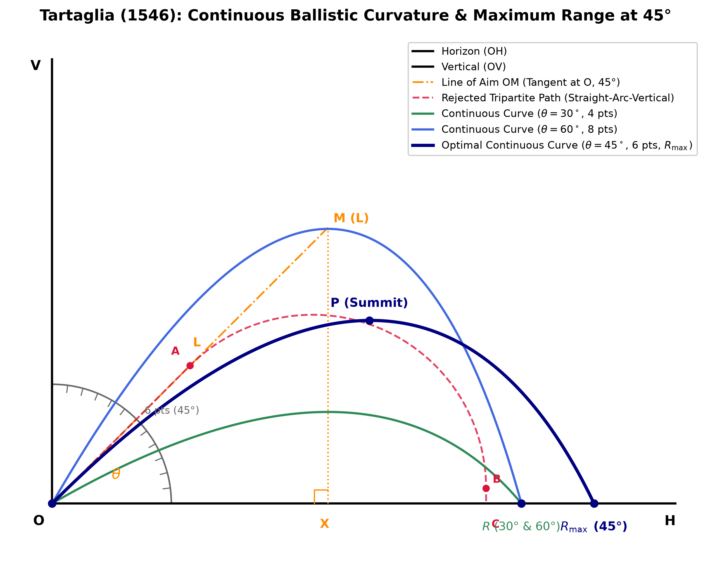

# Quesiti et inventioni diverse (Various Questions and Inventions), Books I & II

* **المؤلف:** Niccolò Fontana Tartaglia (1499/1500–1557) | **التاريخ:** 1546
* **جهة النشر:** Venice: Venturino Ruffinelli, 1546
* **قطعة البازل:** Proved empirically that projectile trajectories are continuously curved throughout (rejecting the tripartite straight-arc-straight path); demonstrated that an elevation angle of 45° yields maximum ballistic range.
* **الجسر السببي:** Solved the scholastic bottleneck of violent vs. natural disjoint motions; directly stimulated Benedetti (B1-005) on continuous impetus and Galileo (B1-050) on parabolic ballistics.
* **الرابط الأرشيفي:** <https://gallica.bnf.fr/ark:/12148/bpt6k1040375x>

---

- **عنوان العمل بالإنجليزية:** \textenglish{(Various Questions and Inventions, Books I & II)}
- **عنوان العمل بالعربية:** (مسائل ومخترعات متنوعة، الكتابان الأول والثاني)

## 1. بطاقة العنوان والهوية
- **الرمز الأرشيفي:** \textenglish{(B1-003)}
- **العالم المؤلف:** نيكولو فونتانا تارتاليا \textenglish{(Niccolò Fontana Tartaglia, 1499/1500--1557)}
- **تاريخ النشر:** \textenglish{(1546)}
- **جهة النشر والأرشيف:** البندقية، مطبعة فينتورينو روفينيلي \textenglish{(Venice: Venturino Ruffinelli, 1546)}
- **الموقع في البناء الفيزيائي التاريخي:** يمثّل الكتابان الأول والثاني من هذا المصنّف نقطة التحوّل الحاسمة التي حطّمت المأزق المدرسي القائل بانفصال الحركة القسرية عن الحركة الطبيعية؛ إذ أثبت تارتاليا تجريبياً وهندسياً أن مسار المقذوف منحنٍ باستمرار منذ لحظة انطلاقه، وأن زاوية الارتفاع البالغة $45^\circ$ (نصف زاوية قائمة) تعطي أعظم مدى أفقي للمدفع، وهو ما مهّد الطريق مباشرة لأبحاث جيوفاني باتيستا بينيديتي \textenglish{(B1-005)} حول الاندفاع المتصل، ولبرهان غاليليو غاليلي \textenglish{(B1-050)} على المسار القطعي المكافئ.

---

## 2. التأصيل التاريخي المنهجي للفكرة
حتى مطلع القرن السادس عشر، كانت الفيزياء المدرسية الأرسطية تحكم فهم حركة القذائف عبر ثنائية صارمة لا تقبل الامتزاج: **الحركة الطبيعية** \textenglish{(Natural Motion)}، وهي حركة الأجسام الثقيلة عمودياً نحو مركز العالم، و**الحركة القسرية** \textenglish{(Violent Motion)}، وهي حركة الجسم المدفوع قسراً على خط مستقيم مائل أو أفقي بفعل محرك خارجي. وبمقتضى هذا التصور الفلسفي، لم يكن يُتصور اجتماع الحركتين في آنٍ واحد على مسار مائل؛ لذا ساد اعتقاد بين المدفعيين وفلاسفة الطبيعة — بل وظهر أثره في كتاب تارتاليا السابق بعنوان «العلم الجديد» \textenglish{(1537)} — بأن القذيفة تتحرك أولاً في **خط مستقيم** بفعل العنف الخالص، ثم تنتقل إلى **قوس دائري** عند تعادل القوتين، وأخيراً تسقط **عمودياً في خط مستقيم** عندما يغلب الثقل الطبيعي.

غير أن الخبرة الميدانية في سلاح المدفعية البندقي أجبرت تارتاليا على مراجعة هذا النموذج الثلاثي المنفصل. ففي حواراته بالكتابين الأول والثاني من عمله الصادر عام \textenglish{(1546)}، عرض تارتاليا نتائج الرماية العملية على المدفعيين والقادة العسكريين، وأدرك تناقضاً جوهرياً في الفرضية القديمة: إذا كانت القذيفة جسماً ثقيلاً يمتلك ثقلاً طبيعياً دائماً لا يتعطل لحظةً واحدة، فكيف يمكن لهذا الثقل أن يتوقف عن جذب القذيفة إلى الأسفل طوال المرحلة المستقيمة الأولى؟ 

من هنا صاغ تارتاليا مراجعته المنهجية الجذرية بأدوات عصره المتاحة حصراً: **أصول إقليدس في الهندسة** \textenglish{(Euclidean Geometry)} (التي كان تارتاليا نفسه قد أتمّ ترجمتها وشرحها قبل ذلك بثلاث سنوات عام \textenglish{(1543)})، و**فيزياء الاندفاع القسري** \textenglish{(Impetus Theory)} المتوارثة عن تقاليد العصور الوسطى، مدعومةً بقياسات **المزولة المدفعية ذات الاثنتي عشرة نقطة** \textenglish{(12-Point Gunner's Quadrant)}. وبذلك انتقل من التوفيق الهندسي الاصطناعي إلى إثبات **الاستمرارية المطلقة لانحناء المسار** وتحديد **شرط المدى الأعظم عند زاوية $45^\circ$**.

---

## 3. التعريفات الرسمية ودليل الرموز \textenglish{(Formal Definitions & Symbol Guide)}
قبل الشروع في التحليل الهندسي، نُعرّف المفاهيم الأصلية كما استخدمها تارتاليا في منتصف القرن السادس عشر:

- **الاندفاع القسري \textenglish{(Violent Impetus)}:** القوة العرضية العنيفة التي يطبعها انفجار البارود في القذيفة لحظة خروجها من فوهة المدفع عند نقطة الأصل $O$، وتتناقص تدريجياً أثناء الطيران بفعل الثقل ومقاومة الوسط.
- **الثقل الطبيعي \textenglish{(Natural Gravity)}:** الميل الجوهري الدائم في الجسم الثقيل للهبوط عمودياً نحو مركز الأرض، وهو حاضر وفاعل في كل لحظة من لحظات الطيران.
- **المسار المتصل المنحني \textenglish{(Continuously Curved Trajectory)}:** الخط الذي ترسمه القذيفة في الهواء نتيجة الامتزاج المستمر غير المنقطع بين الاندفاع القسري والثقل الطبيعي، من غير وجود أي قطعة مستقيمة هندسية خالصة خارج الخط الشاقولي.
- **المزولة المدفعية \textenglish{(Gunner's Quadrant)}:** آلة قياس ربع دائرية تُثبّت في فوهة المدفع لتعيين زاوية الارتفاع $\theta$، ويُقسّم قوسها القائم ($90^\circ$) إلى $12$ قسماً متساوياً تُسمى «نقاطاً» \textenglish{(Points)}، بحيث تعادل كل نقطة $7.5^\circ$، وتقع النقطة السادسة عند منتصف الربع القائم أي $45^\circ$.

| الرمز | الدلالة الهندسية والفيزيائية |
| :--- | :--- |
| $O$ | موضع فوهة المدفع (نقطة الأصل على سطح الأفق). |
| $OH$ | خط الأفق المستقيم الممتد على مستوى الأرض. |
| $OV$ | الخط الشاقولي العمودي على الأفق عند $O$. |
| $OM$ | خط التسديد المائل المماس للمسار عند $O$. |
| $\theta$ | زاوية ارتفاع المدفع المحصورة بين $OM$ و $OH$. |
| $L$ | طول القطعة $OM$ الممثِّل لمقدار الاندفاع القسري الكلي. |
| $X$ | مسقط النقطة $M$ العمودي على خط الأفق $OH$. |
| $P$ | نقطة الذروة (أعلى ارتفاع تبلغه القذيفة في مسارها). |
| $R$ | موضع سقوط القذيفة على الأفق (المدى الأفقي). |
| $R_{\max}$ | المدى الأفقي الأعظم المحقَّق عند زاوية $45^\circ$. |
| $C, D$ | نقطتا التقاطع لقطر نصف الدائرة المساعدة في برهان التوازن. |

---

## 4. تحليل الفرضيات والبديهيات \textenglish{(Axioms & Postulates)}
يقوم برهان تارتاليا في الكتابين الأول والثاني على خمس بديهيات فيزيائية وهندسية متجذّرة في عقلية عام \textenglish{(1546)}:

1. **دوام فعل الثقل الطبيعي:** كل جسم ثقيل يُقذف في الهواء خارج الاتجاه الشاقولي يظل خاضعاً لثقله الطبيعي دون انقطاع في كل جزء من أجزاء المسار، بدءاً من لحظة مغادرة الفوهة $O$.
2. **تناقص الاندفاع القسري:** الاندفاع القسري $L$ الذي يمنحه البارود للقذيفة مقدارٌ محدود يتلاشى تدريجياً خلال المسير، بينما يظل الثقل الطبيعي ثابت الميل نحو الأسفل.
3. **استحالة استقامة الحركة المائلة للثقيل:** لا يمكن لجسم ثقيل أن يسير في خط مستقيم هندسي حقيقي مائل على الشاقول $OV$؛ لأن الاستقامة تشترط غياب أي علة حرفٍ جانبية، في حين أن الثقل يشدّ الجسم عمودياً إلى أسفل في كل لحظة.
4. **مبدأ التقدير الهندسي والتماثل الإقليدي:** تخضع الأبعاد المكانية لمقدار الاندفاع ومساقطه الأفقية والشاقولية لبراهين كتاب الأصول لإقليدس \textenglish{(Euclid's Elements)}، لا سيما الكتاب الأول (في المثلثات ونظرية فيثاغورس)، والكتاب الثاني (في المربعات والمستطيلات)، والكتاب الثالث (في الدوائر والمماسات).
5. **الاحتكام إلى الرصد المدفعي المتكرر:** القياسات الميدانية لمدى القذائف عند زوايا مختلفة (بثبات شحنة البارود ووزن الكرة) تمثل برهاناً حسياً ملزماً لتمييز المسار الحقيقي عن النماذج النظرية المنفصلة.

---

## 5. البرهنة الكاملة خطوة بخطوة بأدوات المؤلف الأصلية مع الوصف التخيلي للشكل

### أ. الوصف التخيلي الدقيق للتكوين الهندسي
تخيّل مستوياً هندسياً شاقولياً يبدأ من نقطة الأصل $O$ على الأرض المستوية. نرسم من $O$ خطاً أفقياً مستقيماً نحو اليمين هو $OH$ (الأفق)، ونقيم عليه من $O$ عموداً إلى أعلى هو $OV$ (الشاقول) بحيث تصنع الزاوية $\angle VOH = 90^\circ$ قائمةً تامة. نرسم ربع دائرة مركزها $O$ تصل بين $OH$ و $OV$ لتمثل قوس المزولة المدفعية المقسم إلى $12$ نقطة.

نختار زاوية ارتفاع $\theta$ ونرسم شعاع التسديد المستقيم $OM$ من $O$، وهو الشعاع الذي يشير إليه محور سبطانة المدفع.
- في **النموذج المدرسي القديم المرفوض** (الذي نرسمه متقطعاً للمقارنة)، تُجبر القذيفة على اتباع القطعة المستقيمة $OA$ المنطبقة على $OM$، ثم تنعطف فجأة عند نقطة $A$ لتسير على قوس دائرة $AB$ يمسّ المستقيم $OA$ عند $A$ ويمسّ خط الهبوط الشاقولي عند $B$، ثم تهبط عمودياً في خط مستقيم $BC$ إلى الأرض.
- أما في **مسار تارتاليا المتصل** (عام \textenglish{(1546)})، فإن المنحنى يخرج من $O$ مماساً لشعاع التسديد $OM$، فلا يطابق $OM$ إلا في نقطة البداية $O$ وحدها، ثم ينفصل عنه انحرافاً لطيفاً جداً غير محسوس للعين المجردة في البداية، ويزداد تقوّسه باطراد نحو الأسفل كلما ضعف الاندفاع، ليصل إلى ذروته عند النقطة $P$، ثم ينحدر من $P$ إلى نقطة السقوط $R$ على الأفق بانحدارٍ أشد وأقرب إلى الشاقول من صعوده، دون أي ركن حاد أو وصلة هندسية مفاجئة.
- ولبيان شرط المدى الأعظم عند $\theta = 45^\circ$، نسقط من طرف قطعة الاندفاع $M$ (التي طولها الثابت $L$) عموداً على الأفق $OH$ يقطعه في النقطة $X$، فيتشكّل لدينا مثلث قائم الزاوية $\triangle OXM$ وتره $OM = L$، وقاعدته الأفقية $OX$، وارتفاعه الشاقولي $XM$.

---

### ب. البرهان الأول: الاستمرارية المنحنية للمسار (بطلان المسار الثلاثي)
يبرهن تارتاليا على استحالة وجود أي قطعة مستقيمة في المسار المائل بأسلوب **البرهان بالخُلف** \textenglish{(Reductio ad Absurdum)} المألوف في هندسة إقليدس:

1. **الفرض العكسي:** لنفترض جدلاً أن القذيفة المنطلقة من $O$ بزاوية ارتفاع $\theta$ (حيث $\theta < 90^\circ$) تقطع قطعةً مستقيمةً هندسيةً تامةً من $O$ إلى نقطة ما $A$ منطبقةً على شعاع التسديد $OM$.
2. **التحليل الفيزيائي للخط المستقيم:** حسب التعريف الهندسي (إقليدس، الكتاب الأول، التعريف الرابع)، الخط المستقيم هو الذي يمتد باستواء واحد دون أي انحراف. وحتى تظل القذيفة منطبقة على $OM$ طوال المسافة $OA$، يجب ألا تؤثر فيها أي علة تحرفها نحو الأسفل أثناء قطع هذه المسافة.
3. **التناقض مع طبيعة الجسم الثقيل:** غير أن القذيفة جسم ثقيل له ثقل طبيعي مستمر الفعل. وبما أن الانتقال من $O$ إلى $A$ يستغرق زماناً غير معدوم، فإن الثقل الطبيعي يجذب القذيفة عمودياً نحو الأسفل في كل جزء من هذا الزمان. وبما أن اتجاه الجذب الشاقولي لا ينطبق على الخط المائل $OM$ (لأن $\theta < 90^\circ$)، فإن القذيفة تنحرف حتماً إلى أسفل $OM$ فور مغادرتها النقطة $O$.
4. **النتيجة البرهانية وتفسير الخداع البصري:** إذن يستحيل هندسياً وفيزيائياً أن تكون القطعة $OA$ مستقيمةً بحق؛ بل المسار منحنٍ انحناءً متصلاً من النقطة $O$ حتى النقطة $R$. وأما ظنّ المدفعيين أن الجزء الأول مستقيم فسببه التفاوت الهائل بين شدة الاندفاع القسري عند الفوهة وضعف الأثر المتراكم للثقل في اللحظات الأولى، مما يجعل مقدار الانحراف عن المماس $OM$ أصغر من أن تدركه العين البشرية، فيبدو المسار *شبه مستقيم* لا مستقيماً حقيقياً. وعندما يتناقص الاندفاع تدريجياً، يظهر الانحناء جلياً بعد الذروة $P$ حيث يزداد انحدار الهبوط باطراد نحو $R$ دون انكسار مفاجئ.

---

### ج. البرهان الثاني: بلوغ المدى الأعظم عند زاوية $45^\circ$ (ست نقاط)
كيف يثبت تارتاليا بأدوات القرن السادس عشر أن النقطة السادسة على المزولة ($\theta = 45^\circ$) تعطي أبعد رمية ممكنة $R_{\max}$ لشحنة بارود ثابتة؟

1. **حصر الطرفين (المتباينة الحدية على الربع القائم):**
   - عندما تكون زاوية الارتفاع $\theta = 0^\circ$ (التسديد الأفقي على $OH$)، لا تملك القذيفة أي ارتفاع شاقولي يُبقيها في الهواء؛ ولذلك يجذبها الثقل الطبيعي فوراً فتهوي إلى الأرض بعد مدى ضئيل جداً (بل يؤول المدى إلى الصفر إذا أُطلقت من مستوى سطح الأرض نفسه).
   - وعندما تكون الزاوية $\theta = 90^\circ$ (التسديد الشاقولي على $OV$)، يُصرف كل الاندفاع القسري في الصعود العمودي، ثم تهبط القذيفة على الخط $OV$ نفسه، فيكون المدى الأفقي معدوماً ($R = 0$).
   - وبما أن القوس القائم متصل بين $0^\circ$ و $90^\circ$، فإن المدى الأعظم $R_{\max}$ لا بد أن يقع عند زاوية وسطى بين هذين الحدين.

2. **الاستدلال الهندسي الإقليدي على التوازن بين الامتداد والرفع:**
   لندرس كيف يتوزع مقدار الاندفاع الكلي الثابت $L = OM$ بين وجهتيْ عمله المتكاملتين في المثلث القائم $\triangle OXM$:
   - الضلع الأفقي $OX$ يمثّل نصيب الاندفاع المتجه **إلى الأمام** بمحاذاة الأفق $OH$ (الذي ينقل القذيفة أفقياً).
   - الضلع الشاقولي $XM$ يمثّل نصيب الاندفاع المتجه **إلى الأعلى** بموازاة $OV$ (الذي يرفع القذيفة ويُطيل بقاءها في الهواء قبل أن يسقطها الثقل إلى الأرض).

   وبتطبيق **مبرهنة فيثاغورس** (إقليدس، الكتاب الأول، القضية \textenglish{(47)}) على المثلث القائم $\triangle OXM$:
   $$OX^2 + XM^2 = OM^2 = L^2$$

   لكي يبلغ المدى الأفقي $R$ أقصى قيمة له، لا يكفي أن يكون الامتداد الأفقي $OX$ كبيراً (كما عند $\theta$ الصغيرة، لأن صغر $XM$ يوقع القذيفة سريعاً)، ولا أن يكون الرفع الشاقولي $XM$ كبيراً (كما عند $\theta$ القريبة من $90^\circ$، لأن صغر $OX$ يضيّع التقدم الأفقي)؛ بل لا بد أن تبلغ **الفعالية المشتركة** للضلعين $OX$ و $XM$ حدّها الأقصى، وهو ما يعبّر عنه هندسياً في عصر تارتاليا بمساحة **المستطيل المحصور بين الضلعين** $OX \cdot XM$ (أو ضعف مساحة المثلث $\triangle OXM$ المرسوم داخل نصف دائرة قطرها $CD = L$ وفق إقليدس، الكتاب الثالث، القضية \textenglish{(31)}).

3. **إيجاد النهاية العظمى باستخدام هندسة المربعات الإقليدية (إقليدس، الكتاب الثاني):**
   من المتطابقة الهندسية المعروفة للمربع المنشأ على فرق قطعتين مستقيمتين (المستخلصة من إقليدس، الكتاب الثاني، القضيتين الرابعة والخامسة):
   $$(OX - XM)^2 = OX^2 + XM^2 - 2 \cdot OX \cdot XM$$
   وبالتعويض من علاقة فيثاغورس $OX^2 + XM^2 = L^2$:
   $$2 \cdot OX \cdot XM = L^2 - (OX - XM)^2$$
   وبالقسمة على $2$:
   $$OX \cdot XM = \frac{L^2 - (OX - XM)^2}{2}$$

   بما أن $L^2$ مقدار ثابت لا يتغير بتغير زاوية المدفع، وبما أن المربع $(OX - XM)^2$ مقدار موجب أو مساوٍ للصفر دائماً، فإن حاصل الضرب $OX \cdot XM$ يبلغ قيمته العظمى المطلقة إذا وفقط إذا انعدم المربع المطروح:
   $$(OX - XM)^2 = 0 \implies OX = XM$$

4. **تعيين زاوية الارتفاع المثلى:**
   عندما يتساوى الضلعان $OX = XM$ في المثلث القائم $\triangle OXM$، يصبح المثلث **متساوي الساقين**؛ وبحسب **إقليدس (الكتاب الأول، القضية الخامسة)** تتساوى زاويتا قاعدته $\angle XOM = \angle XMO = \theta$. وبحسب **إقليدس (الكتاب الأول، القضية \textenglish{(32)})** فإن مجموع زوايا المثلث يساوي قائمتين ($180^\circ$):
   $$\theta + \theta + 90^\circ = 180^\circ \implies 2\theta = 90^\circ \implies \theta = 45^\circ$$
   وهذا يوافق بالضبط **النقطة السادسة** التي تنصّف الربع القائم في المزولة المدفعية، ويُفسّر لماذا تتناقص الرميات تناظرياً كلما ابتعدنا عن $45^\circ$ صعوداً نحو $90^\circ$ أو هبوطاً نحو $0^\circ$، كما تؤكد ذلك قوائم التجارب العملية التي أوردها تارتاليا في مسائل الكتاب الأول.

---

## 6. التمثيل والتطبيق العملي
حوّل تارتاليا هذا الاكتشاف النظري في كتابيه الأول والثاني من «مسائل ومخترعات متنوعة» إلى أداة عملية فورية لمدفعية عصر النهضة:

1. **معايرة المزولة المدفعية وتصحيح جداول الرماية:** قبل عام \textenglish{(1546)}، كان المدفعيون يخلطون بين «الرمي المباشر» \textenglish{(Point-Blank Shot)} والرمي المرفوع لاعتقادهم باستقامة الجزء الأول من المسار. أوضح تارتاليا أن القذيفة تهبط عن خط التسديد $OM$ حتى عند أقل الزوايا وأقصر المسافات، مما ألزم المدفعيين بإدخال تصحيح الارتفاع (التسديد فوق الهدف) منذ المتر الأول.
2. **تقدير نسب المدى عبر النقاط الاثنتي عشرة (مثال تطبيقي):** لنفترض مدفعاً يقذف كرة حديدية بشحنة ثابتة تحقق مدى أعظم قدره $R_{\max} = 1200$ خطوة \textenglish{(paces)} عند النقطة السادسة ($45^\circ$). وفق التماثل حول منتصف الربع القائم الذي أثبته تارتاليا وأكده برصده الميداني:
   - عند النقطة الرابعة ($30^\circ$) والنقطة الثامنة ($60^\circ$) المتناظرتين حول النقطة السادسة، يقل المدى عن $1200$ خطوة ليقارب $1040$ خطوة نظرياً (مع ملاحظة تارتاليا العملية أن الرمية الأعلى عند $60^\circ$ تقصر قليلاً عن نظيرتها عند $30^\circ$ بسبب طول المسار في الهواء وتأثير مقاومة الوسط).
   - عند النقطة الثانية ($15^\circ$) والنقطة العاشرة ($75^\circ$)، ينخفض المدى إلى نحو نصف المدى الأعظم ($600$ خطوة تقريباً).
   - عند النقطة السادسة ($45^\circ$) وحدها يُستثمر المدى الأقصى $1200$ خطوة، وهو ما استخدمه قادة المدفعية لتحديد مدى أمان الحصون ومسافات القصف الميداني.
3. **الأثر البنائي في سلسلة تطور الميكانيكا:** لم يكتفِ تارتاليا بتفنيد المنطق المدرسي المنفصل، بل قدّم المبدأ الحركي الذي التقطه **جيوفاني باتيستا بينيديتي** \textenglish{(B1-005)} في تحليله لاستمرارية الاندفاع والقوة الطاردة، ثم صاغه **غاليليو غاليلي** \textenglish{(B1-050)} صياغةً رياضيةً مكتملةً حين ركّب الحركة الأفقية المنتظمة مع السقوط المتسارع ليبرهن أن هذا المنحنى المتصل عند تارتاليا هو في جوهره **قطع مكافئ** \textenglish{(Parabola)}.
