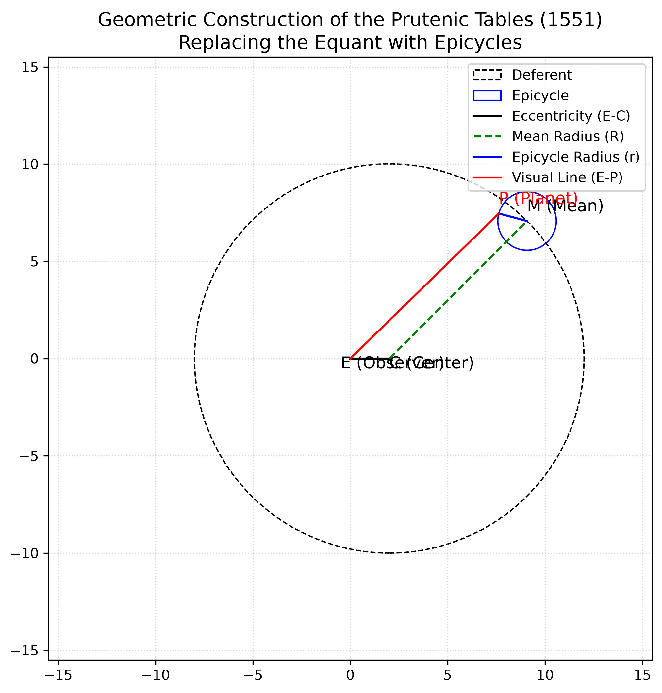

# Prutenicae Tabulae Coelestium Motuum (Prussian Tables of Celestial Motions)

* **المؤلف:** Erasmus Reinhold (1511–1553) | **التاريخ:** 1551
* **جهة النشر:** Tübingen: Ulrich Morhart, 1551
* **قطعة البازل:** First comprehensive astronomical ephemeris calculated entirely from Copernican heliocentric parameters; standardized tabular computation of uniform circular planetary anomalies without Ptolemy's equant.
* **الجسر السببي:** Solved the observational inaccuracy and computational divergence of the Alfonsine Tables; provided Tycho Brahe (B1-010) the reference benchmarks that revealed persistent orbital errors.
* **الرابط الأرشيفي:** <https://doi.org/10.3931/e-rara-24263>

---

**عنوان العمل بالإنجليزية:** \textenglish{Prussian Tables of Celestial Motions}
**عنوان العمل بالعربية:** الجداول البروسية للحركات السماوية

### 1. بطاقة العنوان والهوية
تعد "الجداول البروسية" (\textenglish{Prutenicae Tabulae})، التي نُشرت في عام \textenglish{(1551)}، الوثيقة الرياضية الأخطر في القرن السادس عشر؛ فهي أول تطبيق عملي شامل للنموذج الرياضي الذي وضعه "نيكولاس كوبرنيكوس" (\textenglish{Nicolaus Copernicus}). لم تكن مجرد جداول حسابية، بل كانت "المُعالج الرياضي" الذي نقل الفلك من التخبط في أخطاء "الجداول الألفونسية" (\textenglish{Alfonsine Tables}) القديمة إلى دقة هندسية جديدة. اعتمد "إيراسموس رينهولد" (\textenglish{Erasmus Reinhold}) في بنائها على المعايير الهيليومركزية (\textenglish{heliocentric parameters})، لكنه صاغها بأسلوب يتيح للفلكيين حساب مواقع الكواكب دون الحاجة للاعتراف بفيزيائية حركة الأرض، وهو ما عُرف بـ "تفسير فيتنبرغ" (\textenglish{Wittenberg Interpretation}).

### 2. التأصيل التاريخي المنهجي للفكرة
في منتصف القرن السادس عشر، واجه الملاحون والمنجمون معضلة كبرى: الجداول التقليدية المستندة إلى "بطليموس" (\textenglish{Ptolemy}) بدأت تنحرف عن الواقع المرصود بأيام ودرجات كاملة. تكمن المشكلة في "معدل المسار" (\textenglish{equant})، وهي نقطة وهمية استخدمها بطليموس لضبط السرعة الزاوية، لكنها كسرت مبدأ "الحركة الدائرية المنتظمة" (\textenglish{uniform circular motion}) المقدس.
رأى "رينهولد" أن كوبرنيكوس قدم الحل الهندسي الأكمل عبر استبدال "معدل المسار" بدوائر تدويرية صغيرة (\textenglish{epicycles}) إضافية. وبذلك، أعاد "رينهولد" بناء الفلك على أسس هندسية نقية، حيث كل حركة هي نتاج دوائر تدور بانتظام حول مراكزها، مما أدى إلى توحيد الحسابات الفلكية لأول مرة منذ قرون.

### 3. التعريفات الرسمية ودليل الرموز (Formal Definitions & Symbol Guide)

| الرمز | الدلالة الهندسية والفيزيائية |
| :--- | :--- |
| $C$ | مركز الدائرة الحاملة الرئيسية (\textenglish{Center of the deferent}) |
| $R$ | نصف قطر الدائرة الحاملة (\textenglish{Radius of the deferent}) |
| $r$ | نصف قطر الدائرة التدويرية الصغيرة (\textenglish{Radius of the epicycle}) |
| $E$ | موقع الشمس المتوسطة أو الراصد (\textenglish{Mean Sun or Observer}) |
| $\bar{M}$ | الحركة المتوسطة للكوكب (\textenglish{Mean motion}) |
| $\alpha$ | زاوية الشذوذ أو الاختلاف (\textenglish{Anomaly}) |
| $P$ | الموقع الهندسي للكوكب (\textenglish{Planet's position}) |
| $q$ | زاوية التعديل أو "البروستافيريس" (\textenglish{Prosthaphaeresis}) |

### 4. تحليل الفرضيات والبديهيات (Axioms & Postulates)
1. **بديهية الانتظام:** كل حركة سماوية يجب أن تكون دائرية ومنتظمة تماماً حول مركزها الخاص.
2. **رفض "معدل المسار":** يُمنع استخدام أي نقطة وهمية تجعل الدائرة تبدو منتظمة من منظور غير مركزها؛ وبدلاً من ذلك، تُستخدم التدويرات (\textenglish{epicycles}) لتفسير تغير السرعات.
3. **مرجعية الشمس المتوسطة:** تُحسب جميع حركات الكواكب بالنسبة لمركز مدار الأرض (الشمس المتوسطة)، وليس الأرض الفيزيائية، لضمان تناسق النسب الهندسية.
4. **ثبات الأوج:** يُفترض أن نقاط الأوج (\textenglish{apogee}) تتحرك ببطء شديد جداً، وهي مرجع لقياس الزوايا الطولية.

### 5. البرهنة الكاملة خطوة بخطوة بأدوات المؤلف الأصلية
لإيجاد موقع الكوكب، اتبع "رينهولد" طريقة هندسية تعتمد على تحليل المثلثات الكروية والمسطحة دون استخدام الجبر الحديث، بل عبر "حساب المثلثات الستيني" (\textenglish{sexagesimal trigonometry}).

**الخطوة الأولى: تحديد الحركة المتوسطة (\textenglish{Mean Motion}):**
نبدأ برسم الدائرة الحاملة (\textenglish{deferent}) بمركز $C$ ونصف قطر $R$. يتحرك الخط $CE$ ليمثل مرور الزمن بانتظام. الزاوية التي يصنعها هذا الخط مع نقطة الأصل تُسمى الحركة المتوسطة $\bar{M}$.

**الخطوة الثانية: بناء التدوير المزدوج (\textenglish{Double Epicycle}):**
بدلاً من وضع الكوكب $P$ مباشرة على محيط الدائرة الحاملة، نضع مركز دائرة صغيرة (\textenglish{epicycle}) عند نهاية نصف القطر $R$. نصف قطر هذه الدائرة $r$ يُضبط ليعوض غياب "معدل المسار" البطلمي.

**الخطوة الثالثة: حساب زاوية التعديل (\textenglish{Prosthaphaeresis}):**
هذه هي الخطوة الجوهرية في "الجداول البروسية". نحن بحاجة لإيجاد الزاوية $q$، وهي الفرق بين الموقع المتوسط والموقع الحقيقي كما يُرى من $E$.
تخيل المثلث $ECP$. لدينا الضلع $EC$ (البعد بين المركز والراصد) والضلع $CP$ (الذي يتغير طوله قليلاً بسبب الدائرة التدويرية). باستخدام "قاعدة الجيوب" (\textenglish{Law of Sines}) المتاحة في عصر النهضة:
$$\frac{r}{\sin(q)} = \frac{D}{\sin(\alpha)}$$
حيث $D$ هو المسافة المتغيرة من $E$ إلى $P$.

**الخطوة الرابعة: التجميع النهائي:**
الموقع الطولي الحقيقي للكوكب يساوي:
$$\lambda = \bar{M} \pm q$$
حيث يتم استخراج القيم من الجداول المعدة مسبقاً لكل درجة من درجات الشذوذ $\alpha$.

### 6. التمثيل والتطبيق العملي
في "الجداول البروسية"، قام "رينهولد" بتقسيم هذه العمليات الهندسية المعقدة إلى أعمدة سهلة الاستخدام. يدخل الفلكي بالوقت (\textenglish{السنة، اليوم، الساعة})، فيستخرج من الجدول الأول "الحركة المتوسطة"، ومن الجدول الثاني "تعديل الخاصة" (\textenglish{prosthaphaeresis}) بناءً على زاوية الشذوذ.
هذا النظام سمح لـ "تايكو براهي" (\textenglish{Tycho Brahe}) لاحقاً باكتشاف أن الكواكب لا تتبع هذه الجداول بدقة مطلقة، مما مهد الطريق لـ "كيبلر". لكن في عام \textenglish{(1551)}، كانت هذه الجداول هي قمة الدقة البشرية، حيث استبدلت الفوضى الهندسية بجمال الدوائر المنتظمة المتداخلة.
