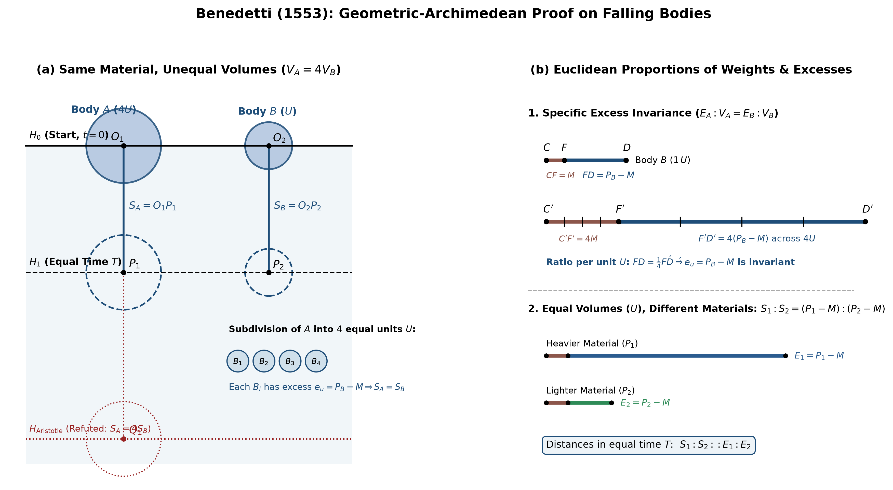

# Resolutio omnium Euclidis problematum aliorumque una tantummodo circini data apertura (Letter on Falling Bodies in Preface)

* **المؤلف:** Giambattista Benedetti (1530–1590) | **التاريخ:** 1553
* **جهة النشر:** Venice: Bartolomeo Cesano, 1553
* **قطعة البازل:** Formulated the first mathematical proof that bodies of the same material but unequal weight fall through a given medium at identical speeds; speed of fall determined by specific gravity difference (v proportional to rho_body - rho_med).
* **الجسر السببي:** Solved the Aristotelian speed-proportional-to-weight fallacy; directly sparked Benedetti's dedicated 1554 treatise (B1-006) and Galileo's early Pisan dynamics (B1-020).
* **الرابط الأرشيفي:** <https://echo.mpiwg-berlin.mpg.de/ECHOdocuViewfull?url=/permanent/library/P10ST3J0/index.meta>

---

**عنوان العمل بالإنجليزية:** \textenglish{(Resolution of All Problems of Euclid and Others with a Single Given Opening of the Compass: Letter on Falling Bodies in Preface)}
**عنوان العمل بالعربية:** حل جميع مسائل إقليدس وغيرها بفتحة واحدة معلومة للفرجار (رسالة في الأجسام الساقطة في المقدمة)

## 1. بطاقة العنوان والهوية

- **الرمز الأرشيفي:** \textenglish{(B1-005)}
- **المؤلف:** جيامباتيستا بينيديتي \textenglish{(Giambattista Benedetti, 1530--1590)}
- **سنة النشر ومكانه:** البندقية \textenglish{(Venice)}، مطبعة بارتولوميو تشيزانو \textenglish{(Bartolomeo Cesano)}، عام \textenglish{(1553)}
- **طبيعة النص وموضعه:** رسالة علمية تمهيدية أدرجها المؤلف في مقدمة كتابه الهندسي المخصص لحل مسائل إقليدس بفتحة فرجار واحدة ثابتة، ووجّهها إلى الأب غابرييل دي غوزمان \textenglish{(Gabriel de Guzman)}.
- **الأطروحة المركزية:** صياغة أول برهان رياضي هندسي وهيدروستاتيكي يثبت أن الأجسام المتجانسة المصنوعة من المادة نفسها تسقط في الوسط الواحد بالسرعة نفسها مهما اختلفت أوزانها الكلية، وأن سرعة السقوط في الوسط تتناسب طردياً مع فائض وزن الوحدة الحجمية من الجسم على وزن الوحدة الحجمية من الوسط.

## 2. التأصيل التاريخي المنهجي للفكرة

ينتمي هذا العمل إلى اللحظة المفصلية في عصر النهضة الإيطالية حين التقت المدرسة الهندسية الإقليدية بفيزياء أرخميدس المائية في مدينة البندقية منتصف القرن السادس عشر. كان جيامباتيستا بينيديتي في الثالثة والعشرين من عمره عام \textenglish{(1553)}، وقد تلقى تكوينه الرياضي على يد عالم الرياضيات والمهندس نيكولو تارتاليا \textenglish{(Niccolo Tartaglia, 1499--1557)}، الذي كان قد نشر قبل ذلك بعشر سنوات تحديداً عام \textenglish{(1543)} الترجمة اللاتينية لرسالة أرخميدس في الأجسام الطافية، ثم أتبعها بشروحه الإيطالية عام \textenglish{(1551)}.

قبل هذه الرسالة، سادت في الجامعات الأوروبية الفيزياء المدرسية المستندة إلى كتابي السماع الطبيعي وفي السماء لأرسطو. زعم أرسطو أن سرعة الهبوط الطبيعي للأجسام المصنوعة من المادة نفسها في وسط معين تتناسب طردياً مع أوزانها المطلقة الكلية؛ فإذا كان حجر يزن عشرة أمثال حجر آخر من النوع نفسه، وجب عند أرسطو أن يقطع المسافة نفسها في عُشر الزمن، أو أن يقطع عشرة أمثال المسافة في الزمن نفسه. كما رأى أرسطو أن السرعة تتناسب عكسياً مع كثافة الوسط الذي يخترقه الجسم.

أدرك بينيديتي أن هذا التصور الأرسطي يتهاوى بمجرد إخضاعه لمبادئ أرخميدس في الأجسام الطافية ولنظرية التناسب في المقالة الخامسة من كتاب الأصول لإقليدس. فالحركة الطبيعية للنزول في وسط مادي كالهواء أو الماء لا يحكمها الوزن المطلق للجسم في ذاته، بل يحكمها الفرق بين ثقل الجسم وثقل حجم مساوٍ له من الوسط الذي يزيحه. ورغم أن هذه الرسالة وردت في مقدمة كتاب هندسي خالص عن الإنشاءات الهندسية بالفرجار الثابت، فإنها أحدثت دوياً فكرياً أجبر بينيديتي بعد عام واحد فقط على تأليف رسالة مستقلة وموسعة عام \textenglish{(1554)} بعنوان البرهان على نسب الحركات المكانية ضد أرسطو وجميع الفلاسفة \textenglish{(B1-006)}، وهو المسار الذي استلهمه غاليليو غاليلي مباشرة في مخطوطاته البيزية المبكرة في الحركة \textenglish{(B1-020)} لتأسيس علم الديناميكا الحديث.

## 3. التعريفات الرسمية ودليل الرموز \textenglish{(Formal Definitions & Symbol Guide)}

بما أن علم الجبر الرمزي الحديث وحساب التفاضل والتكامل ومفهوم متجهات القوة لم تكن موجودة في عام \textenglish{(1553)}، فإن بينيديتي يعتمد حصراً على المنهج الإقليدي في تمثيل المقادير الفيزيائية (الأوزان، الأحجام، والمسافات المقطوعة في أزمنة متساوية) بقطع مستقيمة هندسية وتناسبات عددية بين مقادير متجانسة. وفيما يلي التعريفات الدقيقة للمفاهيم المستخدمة في البرهان:

1. **السرعة في المفهوم الكلاسيكي \textenglish{(Velocitas)}:** تُعرَّف نسبة سرعتي جسمين متحركين طبيعياً بنسبة المسافتين الرأسيتين $S_A$ و $S_B$ اللتين يقطعهما كل منهما خلال فترة زمنية متساوية ومعلومة $T$.
2. **الوزن النوعي المقارَن \textenglish{(Weight per Equal Volume)}:** هو الوزن المطلق $P$ لمقدار حجمي معياري ثابت $U$ من مادة الجسم، ويُقابَل بوزن $M$ لنفس المقدار الحجمي المعياري $U$ من مادة الوسط.
3. **الفائض الوزني المحرك في الوسط \textenglish{(Excess Weight)}:** هو المقدار المتبقي $E$ من وزن الجسم بعد طرح وزن الكمية المزاحة من الوسط، وهو السبب الطبيعي الفاعل للنزول وفق هيدروستاتيكا أرخميدس.

| الرمز | الدلالة الهندسية والفيزيائية |
| :--- | :--- |
| $A, B$ | جسمان كرويان متجانسان يُختبران في وسط مائع منتظم |
| $U$ | حجم معياري ثابت وموحد للمقارنة بين الأجسام والوسط |
| $V_A, V_B$ | الحجمان الهندسيان للجسمين $A$ و $B$ مقاسين بوحدة $U$ |
| $k$ | نسبة عددية أو هندسية صحيحة تساوي $V_A$ إلى $V_B$ |
| $P_A, P_B$ | الوزن المطلق لوحدة الحجم $U$ من مادتي $A$ و $B$ |
| $W_A, W_B$ | الوزن المطلق الكلي لكل من الجسمين $A$ و $B$ |
| $M$ | وزن وحدة الحجم المعياري $U$ من مادة الوسط المحيط |
| $M_A, M_B$ | وزن حجم الوسط الذي يزيحه كل من الجسمين $A$ و $B$ |
| $E_A, E_B$ | الفائض الوزني المحرك الكلي للجسمين داخل الوسط |
| $e_u$ | الفائض الوزني النوعي المحرك لكل وحدة حجمية $U$ |
| $T$ | فترة زمنية متساوية ومعلومة تُقاس خلالها حركة السقوط |
| $S_A, S_B$ | المسافتان المقطوعتان خلال الزمن $T$ بوصفهما مقياس السرعة |
| $O_1, O_2$ | مركزا الثقل الهندسيان للجسمين $A$ و $B$ عند خط البدء |
| $C, D, F$ | نقاط تحدد القطع المستقيمة الممثلة للأوزان والفوائض |
| $P_1, P_2, Q_1$ | نقاط وصول المراكز بعد الزمن $T$ فعلياً وأرسطياً |

## 4. تحليل الفرضيات والبديهيات \textenglish{(Axioms & Postulates)}

يقيم بينيديتي برهانه لعام \textenglish{(1553)} على أربع مسلمات مستمدة حصراً من تراث أرخميدس وإقليدس وأصول الحركة المقبولة في عصره:

1. **بديهية قياس السرعة عبر المسافات في الأزمنة المتساوية:** إذا تحرك جسمان خلال فترة زمنية واحدة $T$، فإن نسبة سرعة الأول إلى سرعة الثاني تساوي نسبة المسافة المقطوعة $S_A$ إلى المسافة المقطوعة $S_B$.
2. **مسلمة أرخميدس في الأجسام الطافية:** كل جسم أثقل نوعياً من الوسط الذي يُغمر فيه يفقد من وزنه قدراً مساوياً تماماً لوزن الوسط الذي يزيحه حجمُه $V$؛ ومن ثم فإن ثقله المحرك الفعلي داخل الوسط ليس وزنه المطلق $W$، بل فائضه $E = W - M_V$.
3. **مسلمة التناسب للأحجام المتساوية:** إذا تساوى جسمان $A$ و $B$ في الحجم ($V_A = V_B = U$) والشكل الكروي، فإنهما يزيحان قدراً متساوياً من الوسط ويلقيان منه العائق الهندسي نفسه، فتكون نسبة المسافتين المقطوعتين في الزمن $T$ مساوية تماماً لنسبة فائضي وزنيهما في ذلك الوسط.
4. **بديهية التجانس والتركيب الهندسي في المقالة الخامسة لإقليدس:** الجسم المتجانس ذو الحجم المضاعف $V_A = k U$ يتكافأ طبيعياً مع اجتماع $k$ أجزاء متماثلة لكل منها الحجم $U$؛ وإن اتصال هذه الأجزاء المتساوية معاً أو انفصالها جنباً إلى جنب لا يولد في أي جزء منها ميلاً جديداً أسرع نحو المركز، ولا يُنقص من ميله الذاتي شيئاً.

## 5. البرهنة الكاملة خطوة بخطوة بأدوات المؤلف الأصلية مع الوصف التخيلي للشكل

### الوصف التخيلي للتكوين الهندسي
تخيل وسطاً مائعاً منتظماً محصوراً أسفل الخط الأفقي الأعلى $H_0$ الذي يمثل موضع الانطلاق عند بدء الزمن $T$. نضع عند الخط $H_0$ كرتين من المادة المتجانسة نفسها: كرة كبيرة $A$ مركزها النقطة $O_1$ وحجمها $V_A = k U$ (لنأخذ في التمثيل الهندسي $k = 4$)، وبجوارها كرة صغيرة $B$ مركزها النقطة $O_2$ وحجمها المعياري $V_B = U$. نرسم أسفل الخط $H_0$ الخط الأفقي $H_1$ ليمثل الموضع الذي تبلغه المراكز بعد انقضاء الزمن $T$ وفق برهان بينيديتي، بحيث تكون المسافة الرأسية $S_A = O_1 P_1$ مساوية تماماً للمسافة الرأسية $S_B = O_2 P_2$. وفي الأسفل البعيد، نرسم خطاً متقطعاً عند النقطة $Q_1$ على مسافة $O_1 Q_1 = k \cdot O_2 P_2$ ليمثل التنبؤ الأرسطي الخاطئ الذي يريد بينيديتي نقضه.

وإلى جانب مسار السقوط، ننشئ الرسم الهندسي المساند للمقادير وفق أسلوب المقالة الخامسة من الأصول: نرسم قطعة مستقيمة $CD$ تمثل الوزن المطلق $P_B$ للوحدة الحجمية $U$ من مادة الكرة، ونقتطع منها القطعة $CF$ الممثلة لوزن الحجم نفسه $U$ من الوسط ($M$)؛ فتكون القطعة الباقية $FD$ هي الفائض الوزني المحرك $E_B = P_B - M$. وبالمثل نرسم للكرة الكبيرة $A$ قطعة مستقيمة طويلة $C'D'$ تتألف من وصل $k$ قطع متساوية كل منها مساوٍ للقطعة $CD$، ونقتطع منها القطعة $C'F'$ المؤلفة من $k$ قطع متساوية كل منها مساوٍ للقطعة $CF$؛ فيكون الباقي $F'D'$ مؤلفاً من $k$ أجزاء متساوية كل منها مساوٍ للقطعة الباقية $FD$.

### خطوات البرهان الرياضي لعام \textenglish{(1553)}

#### أولاً: إثبات تناسب السرعة مع الفائض الوزني لجسمين متساويي الحجم ومختلفي المادة
ليكن لدينا جسمان كرويان متساويان تماماً في الحجم والشكل، بحيث $V_A = V_B = U$، لكنهما من مادتين مختلفتين وزناهما المطلقان للوحدة الحجمية $U$ هما $P_A$ و $P_B$، وكلاهما أثقل من وزن الحجم المساوي من الوسط $M$ (أي $P_A > P_B > M$).

بموجب مسلمة أرخميدس، فإن الكرة الأولى تزيح حجماً $U$ من الوسط وزنه $M$، فيكون فائض وزنها الفعلي المحرك للنزول هو:
$$E_A = P_A - M$$
وبالطريقة نفسها، تزيح الكرة الثانية الحجم نفسه $U$ من الوسط، فيكون فائض وزنها المحرك هو:
$$E_B = P_B - M$$
ولما كان الجسمان متساويين في الحجم والشكل، فإن مقاومتي الوسط الهندسية لهما متكافئتان؛ لذا بموجب مسلمة التناسب الإقليدية للأحجام المتساوية، تتناسب المسافتان المقطوعتان $S_A$ و $S_B$ في الزمن الواحد $T$ تناسباً طردياً مع هذين الفائضين:
$$S_A : S_B = (P_A - M) : (P_B - M)$$
وهذه هي القاعدة الأساسية التي تحدد سرعة الهبوط في أي وسط بدلالة فرق الثقل النوعي بين الجسم والوسط.

#### ثانياً: البرهان على تساوي سرعتي جسمين غير متساويين من المادة نفسها
نفترض الآن أن الجسمين $A$ و $B$ مصنوعان من المادة المتجانسة نفسها، ولكن حجم $A$ يساوي $k$ أمثال حجم $B$، أي إن $V_B = U$ و $V_A = k U$ (حيث $k > 1$).

1. **حساب الفائض الكلي لكل جسم:**
   للجسم الصغير $B$ وزن مطلق يساوي $W_B = P_B$، ويزيح من الوسط وزناً مقداره $M_B = M$، فيكون فائضه الوزني المحرك (الممثل بالقطعة $FD$) هو:
   $$E_B = P_B - M$$
   أما الجسم الكبير $A$ المتجانس مع $B$، فبما أن حجمه $k U$، فإن وزنه المطلق الكلي يساوي $W_A = k P_B$ (الممثل بالقطعة $C'D'$)، كما أنه يزيح حجماً من الوسط مقداره $k U$ وزنه $M_A = k M$ (الممثل بالقطعة $C'F'$). ومن ثم يكون الفائض الوزني الكلي للجسم $A$ (الممثل بالقطعة $F'D'$) هو:
   $$E_A = W_A - M_A = k P_B - k M = k (P_B - M) = k E_B$$

2. **تطبيق قضية المضاعفات المتساوية من المقالة الخامسة لإقليدس:**
   هنا يكشف بينيديتي موطن الزلل الأرسطي؛ فقد نظر أرسطو إلى تضاعف الوزن $W_A = k W_B$ (أو الفائض الكلي $E_A = k E_B$) وتغافل عن أن مقدار المادة المتحركة قد تضاعف بالنّسبة نفسها $k$ أيضاً. فإذا قسمنا الفائض الكلي على الحجم الكلي لكل جسم وفق نظرية النسب الإقليدية، نجد أن الفائض الوزني النوعي المحرك $e_u$ لكل وحدة حجمية $U$ متطابق تماماً في الجسمين:
   $$E_A : V_A = k (P_B - M) : k U = (P_B - M) : U = E_B : V_B$$
   أي إن نصيب كل وحدة حجمية $U$ داخل الكرة الكبيرة $A$ من القوة المحركة الفائضة يساوي:
   $$e_u = P_B - M$$
   وهو بعينه الفائض المحرك للكرة الصغيرة $B$.

3. **برهان التجزئة الهندسية والتركيب:**
   لترسيخ الحجة بصورة قاطعة، يتصور بينيديتي تقسيم الكرة الكبيرة $A$ ذهنياً إلى $k$ أجزاء متساوية $B_1, B_2, \dots, B_k$، حجم كل جزء منها $U$ ووزنه المطلق $P_B$.
   - إذا أُسقطت هذه الأجزاء المتساوية $k$ جنباً إلى جنب في الوسط نفسه وهي منفصلة تماماً بعضها عن بعض بفواصل دقيقة، فإن كل جزء منها يزيح قدراً $M$ من الوسط، ويمتلك الفائض نفسه $P_B - M$، ومن ثم يقطع كل واحد منها المسافة $S_B$ خلال الزمن $T$.
   - والآن، إذا أُعيد ضم هذه الأجزاء المتساوية $k$ بعضها إلى بعض لتلتحم وتكوّن الجسم الواحد $A$، فلن ينشأ من مجرد تماسها أي ثقل نوعي إضافي في أي جزء منها، ولن ينقص دفع الوسط المحيط لكل وحدة حجمية منها. وبما أن أياً من الأجزاء لا يملك ميلاً ذاتياً لتجاوز المسافة $S_B$ في الزمن $T$، فإن مجموعها المتصل لا يملك سبباً طبيعياً للاندفاع أسرع من أجزائه ولا أبطأ منها.

وعليه، تقطع الكرة الكبيرة $A$ من $O_1$ إلى $P_1$ المسافة $S_A = O_1 P_1$ في الزمن $T$ نفسه الذي تقطع فيه الكرة الصغيرة $B$ من $O_2$ إلى $P_2$ المسافة $S_B = O_2 P_2$، فيتحقق المطلوب إثباته:
$$S_A = S_B$$
وهو ما يهدم القول الأرسطي بوصول $O_1$ إلى $Q_1$.

## 6. التمثيل والتطبيق العملي

لإيضاح القيمة التطبيقية لبرهان بينيديتي بأسلوب الموازين المائية في عصر النهضة، نطبق القاعدة على حالتين عمليتين داخل الماء باستخدام وحدة حجمية قياسية $U$ ووحدات وزن تقليدية (حيث نعتبر وزن وحدة حجم الماء $M = 1$ وحدة وزن):

1. **مقارنة كرتين من الرصاص غير متساويتين في الحجم داخل الماء:**
   ليكن وزن الوحدة الحجمية من الرصاص $P_B = 11$ وحدة وزن.
   - الكرة الصغيرة $B$ حجمها $U$: وزنها المطلق $11$ وحدة، وتزيح ماءً وزنه $1$ وحدة، فيكون فائضها الفعلي $E_B = 11 - 1 = 10$ وحدات لكل وحدة حجمية $U$ (أي $e_u = 10$).
   - الكرة الكبيرة $A$ حجمها $4 U$: وزنها المطلق $W_A = 4 \times 11 = 44$ وحدة، وتزيح ماءً وزنه $M_A = 4 \times 1 = 4$ وحدات، فيكون فائضها الكلي $E_A = 44 - 4 = 40$ وحدة موزعة على $4$ وحدات حجمية، فيظل الفائض النوعي المحرك $e_u = 40 : 4 = 10$ وحدات لكل وحدة $U$.
   - **النتيجة العملية:** إذا أُسقطت الكرتان معاً في حوض ماء عميق، فإنهما تقطعان المسافة الرأسية نفسها $S_A = S_B$ في الزمن نفسه $T$، خلافاً للتوقع الأرسطي الذي افترض أن الكرة ذات الوزن $44$ تقطع أربعة أمثال مسافة الكرة ذات الوزن $11$.

2. **مقارنة كرتين متساويتي الحجم $U$ من الرصاص والحجر داخل الماء:**
   ليكن وزن وحدة الرصاص $P_1 = 11$ وحدة وزن، ووزن وحدة الحجر $P_2 = 3$ وحدات وزن، ووزن وحدة الماء $M = 1$ وحدة وزن.
   - الفائض الفعلي لكرة الرصاص في الماء: $E_1 = 11 - 1 = 10$ وحدات.
   - الفائض الفعلي لكرة الحجر في الماء: $E_2 = 3 - 1 = 2$ وحدتان.
   - **النتيجة العملية:** وفق برهان بينيديتي، فإن نسبة المسافة التي يقطعها الرصاص إلى المسافة التي يقطعها الحجر المساوي له في الحجم خلال الزمن نفسه $T$ في الماء تساوي:
     $$S_1 : S_2 = 10 : 2 = 5 : 1$$
   - أي إن كرة الرصاص تقطع في الماء خمسة أمثال المسافة التي تقطعها كرة الحجر، وليس نسبة وزنيهما المطلقين $11 : 3$ التي أهملت تأثير دفع الوسط الأرخميدي.
