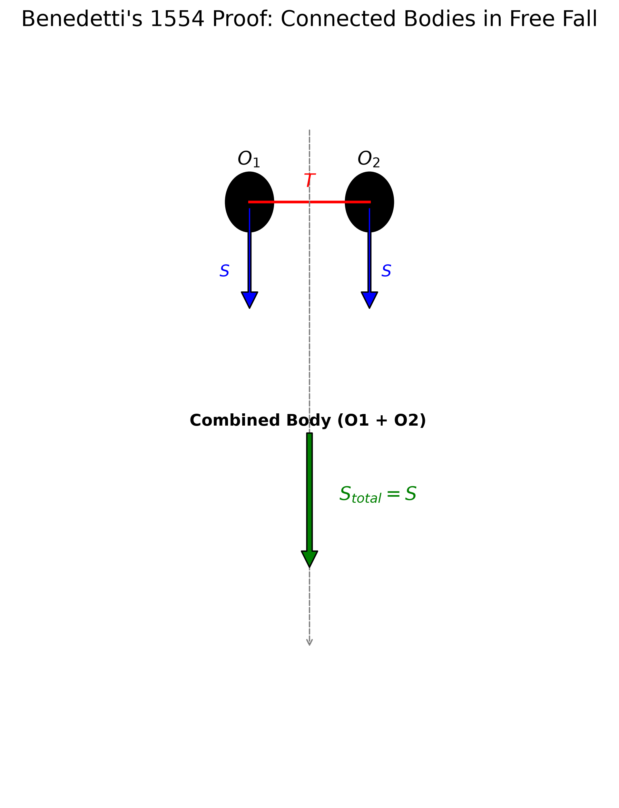

# Demonstratio proportionum motuum localium contra Aristotelem et omnes philosophos (Demonstration of Proportions of Local Motions against Aristotle)

* **المؤلف:** Giambattista Benedetti (1530–1590) | **التاريخ:** 1554
* **جهة النشر:** Venice: Bartolomeo Cesano, 1554
* **قطعة البازل:** Rigorous hydrostatic reduction of free fall: two bodies of identical material connected by a weightless thread fall at the same speed as either alone; velocity in vacuo would be finite and equal for all homogeneous bodies.
* **الجسر السببي:** Solved the scholastic paradox of connected falling bodies; enabled Stevin & De Groot (B1-017) to conduct tower drop tests and Galileo (B1-020) to frame De Motu.
* **الرابط الأرشيفي:** <https://mdz-nbn-resolving.de/urn:nbn:de:bvb:12-bsb10143890-5>

---

**عنوان العمل بالإنجليزية:** \textenglish{Demonstration of the Proportions of Local Motions against Aristotle and all Philosophers}
**عنوان العمل بالعربية:** برهان تناسب الحركات الموضعية ضد أرسطو وجميع الفلاسفة

### 1. بطاقة العنوان والهوية
تعد هذه الورقة، المنشورة في البندقية عام \textenglish{1554}، الوثيقة التأسيسية التي زعزعت أركان الفيزياء الأرسطية التي سادت لألفي عام. في هذا العمل، يقدم "جيامباتيستا بينيديتي" \textenglish{(Giambattista Benedetti)} صياغة رياضية وهيدروستاتيكية صارمة لنقد نظرية السقوط الحر، معتمداً على مبادئ أرشميدس بدلاً من فيزياء أرسطو الكيفية. يكمن جوهر العمل في إثبات أن سرعة الأجسام الساقطة لا تعتمد على ثقلها الكلي، بل على ثقلها النوعي بالنسبة للوسط.

### 2. التأصيل التاريخي المنهجي للفكرة
في منتصف القرن السادس عشر، كانت القاعدة السائدة هي قول أرسطو إن سرعة الجسم تتناسب طردياً مع ثقله وعكسياً مع كثافة الوسط. فكر "بينيديتي" بعقلية المهندس والرياضي المتأثر بإعادة اكتشاف أعمال أرشميدس. رأى أن السقوط الحر ليس مجرد "نزوع طبيعي" للمادة نحو مركز الأرض، بل هو عملية ميكانيكية تخضع لقوانين الطفو. إذا كان الجسم مغموراً في وسط (هواء أو ماء)، فإن الوسط يقاوم حركته بقوة تعادل وزن الوسط المزاح. لذا، فإن المحرك الفعلي للحركة هو الفرق بين الثقل النوعي للجسم والثقل النوعي للوسط.

### 3. التعريفات الرسمية ودليل الرموز \textenglish{(Formal Definitions & Symbol Guide)}

| الرمز | الدلالة الهندسية والفيزيائية |
| :--- | :--- |
| $O_1, O_2$ | جرمان متماثلان من نفس المادة والشكل |
| $V$ | الحجم الهندسي للجسم الساقط |
| $P$ | الثقل النوعي للمادة المكونة للجسم |
| $M$ | الثقل النوعي للوسط المحيط (المقاومة) |
| $S$ | السرعة المكتسبة أثناء السقوط الموضعي |
| $T$ | الرابط الخطي (الخيط) عديم الوزن |

### 4. تحليل الفرضيات والبديهيات \textenglish{(Axioms & Postulates)}
1. **بديهية التماثل:** الأجسام المكونة من مادة واحدة لها نفس الخصائص الجوهرية والنزوع للحركة، بغض النظر عن حجمها.
2. **فرضية أرشميدس:** أي جسم مغمور في وسط سائل (أو غازي) يفقد من ثقله مقداراً مساوياً لثقل الوسط الذي يزيحه.
3. **مبدأ التناسب:** السرعة $S$ لا تتحدد بالثقل المطلق للجسم، بل بالفضل (الفرق) بين ثقل الجسم $P$ وثقل الوسط $M$.
4. **استحالة التناقض:** لا يمكن لربط جسمين متماثلين أن يغير من سرعة أي منهما ما دام النزوع للحركة متساوياً فيهما.

### 5. البرهنة الكاملة خطوة بخطوة بأدوات المؤلف الأصلية

**الوصف التخيلي للشكل الهندسي:**
تخيل خطاً عمودياً يمثل مسار السقوط. في أعلى الخط، نضع جرمان كرويان متماثلان تماماً $O_1$ و $O_2$. نصل بين مركزي الجرمين بخط مستقيم رفيع $T$ يمثل خيطاً لا وزن له.

**خطوات البرهان:**
1. لنفترض، تماشياً مع مذهب أرسطو، أن السرعة $S$ تتناسب مع الثقل. إذا تركنا الجرم $O_1$ يسقط وحده، فإنه سيتحرك بسرعة معينة $S$.
2. وبما أن الجرم $O_2$ مماثل تماماً لـ $O_1$ في المادة والحجم، فإنه إذا سقط وحده سيتحرك بنفس السرعة $S$.
3. الآن، لنربط $O_1$ و $O_2$ بواسطة الرابط $T$. الجسم الناتج $(O_1 + O_2)$ أصبح ثقله ضعف ثقل الجسم الواحد.
4. حسب منطق أرسطو، يجب أن يسقط الجسم المركب $(O_1 + O_2)$ بسرعة تبلغ ضعف السرعة الأصلية $2S$.
5. **هنا يكمن الاعتراض الجوهري لبينيديتي:** كيف يمكن للرابط $T$ أن يزيد من سرعة $O_1$؟ إن $O_1$ يتحرك بفعله الطبيعي بسرعة $S$، و $O_2$ يتحرك بسرعة $S$. لا يوجد أي سبب ميكانيكي يجعل أحدهما يدفع الآخر أو يسحبه لزيادة سرعته، لأن نزوعهما للحركة متساوٍ تماماً.
6. إذاً، الجسم المركب $(O_1 + O_2)$ سيتحرك بنفس السرعة $S$ التي يتحرك بها كل جزء على حدة.
7. **النتيجة:** الثقل الكلي ليس هو محدد السرعة. المحدد هو النسبة بين الثقل والحجم (الثقل النوعي).
8. **الاستنتاج في الفراغ:** إذا انعدم الوسط $M$ (أي أصبح الثقل النوعي للوسط صفراً)، فإن جميع الأجسام المكونة من نفس المادة ستسقط في الفراغ بنفس السرعة المحدودة، لأن المقاومة تلاشت وبقي النزوع الجوهري للمادة فقط.

### 6. التمثيل والتطبيق العملي
هذا البرهان الرياضي الذي قدمه "بينيديتي" هو الذي مهد الطريق لتجارب إسقاط الأجسام من الأبراج. فإذا أخذنا كرتين من الرصاص، إحداهما تزن رطلاً والأخرى تزن عشرة أرطال، فإنهما ستصلان إلى الأرض في وقت واحد تقريباً (بإهمال فروق مقاومة الهواء الطفيفة)، لأن الثقل النوعي للرصاص ثابت. هذا العمل هو الذي استند إليه "ستيفين" في تجاربه عام \textenglish{1586}، وهو الذي صاغ منه "غاليلو" مسوداته الأولى في كتابه "عن الحركة" \textenglish{(De Motu)}، محولاً الفيزياء من التفسير الفلسفي إلى البرهان الهندسي.
