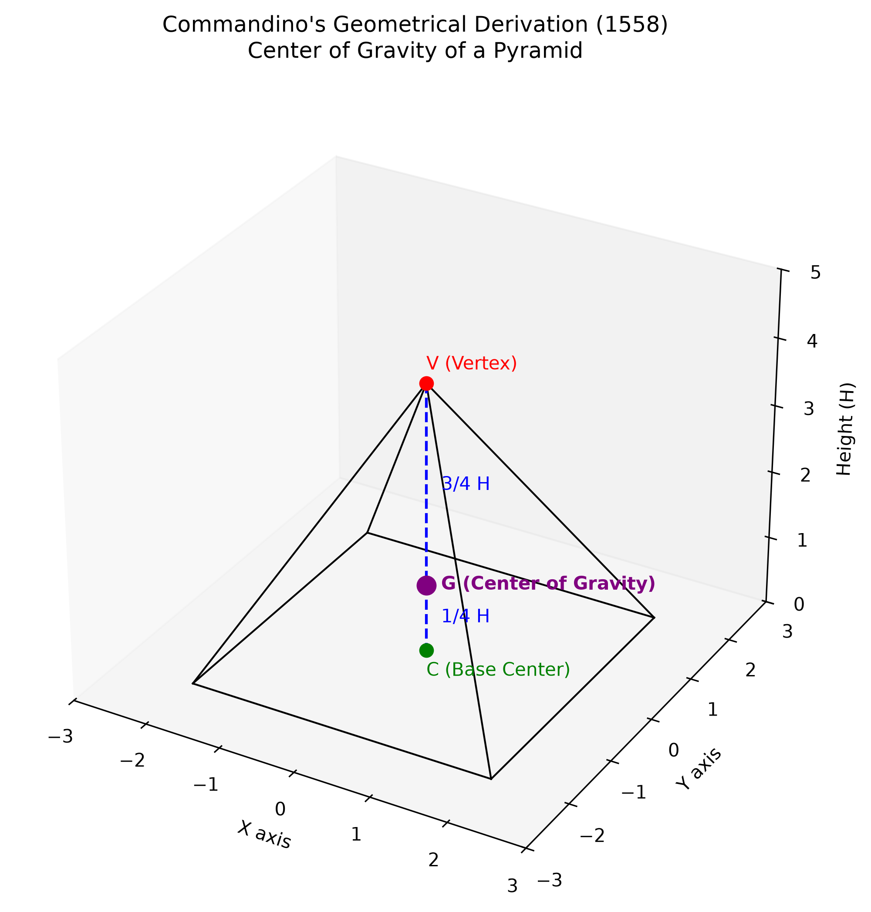

# Liber de centro gravitatis solidorum (Book on the Center of Gravity of Solids)

* **المؤلف:** Federico Commandino (1509–1575) | **التاريخ:** 1558
* **جهة النشر:** Bologna: Alessandro Benacci, 1558
* **قطعة البازل:** Geometrical derivation of centers of gravity of 3D solids (pyramids, cones, paraboloids of revolution); generalized Archimedean planar equilibrium to volumetric spatial distributions.
* **الجسر السببي:** Solved the spatial limitation of Archimedean planar statics; directly provided the mathematical apparatus for Guidobaldo del Monte's statics (B1-013) and Galileo's 1588 center-of-gravity theorems (B1-050 app.).
* **الرابط الأرشيفي:** <https://archive.org/details/liberdecentrogra00comm>

---

**1. بطاقة العنوان والهوية**

*   **عنوان العمل بالإنجليزية:** \textenglish{Book on the Center of Gravity of Solids}
*   **عنوان العمل بالعربية:** كتاب في مركز ثقل الأجسام الصلبة

---

**2. التأصيل التاريخي المنهجي للفكرة**

نحن الآن في عام \textenglish{1558}، في قلب عصر النهضة الإيطالية. العلم الذي بين أيدينا ليس مجرد فيزياء، بل هو "استاتيكا" هندسية (Statics) تعتمد كلياً على إرث أرخميدس \textenglish{(Archimedes)}. قبل هذا العمل، كان العالم يعرف كيف يحدد مراكز ثقل الأشكال المسطحة (مثل المثلثات والدوائر) بفضل كتاب أرخميدس "عن توازن المستويات"، لكن الأجسام ثلاثية الأبعاد ظلت لغزاً رياضياً دون برهنة هندسية صارمة.

يسعى فيديريكو كوماندينو \textenglish{(Federico Commandino)} في هذا العمل إلى سد الفجوة الكبرى: نقل قوانين الرافعة والميزان من "المساحات" إلى "الأحجام". المنهج المتبع هو "منهج الاستنفاد" \textenglish{(Method of Exhaustion)} اليوناني، حيث لا نستخدم التكامل (الذي لم يُخترع بعد)، بل نستخدم تقريب الجسم الصلب بسلسلة من الأجسام الأبسط (مثل المنشورات) التي تملأ الفراغ تدريجياً حتى يتطابق البرهان. هذا العمل هو الحجر الأساس الذي سيبني عليه غيدوبالدو ديل مونتي \textenglish{(Guidobaldo del Monte)} وجاليلو \textenglish{(Galileo)} أبحاثهما اللاحقة.

---

**3. التعريفات الرسمية ودليل الرموز (Formal Definitions & Symbol Guide)**

يُعرف كوماندينو "مركز الثقل" بأنه: "تلك النقطة داخل الجسم التي إذا عُلق منها الجسم، فإنه يظل في حالة اتزان وسكون في أي وضعية وُضع فيها".

| الرمز | الدلالة الهندسية والفيزيائية |
| :--- | :--- |
| $V$ | رأس الهرم أو المخروط \textenglish{(Vertex)} |
| $C$ | مركز ثقل القاعدة المستوية \textenglish{(Center of Base)} |
| $G$ | مركز ثقل الجسم الصلب الكلي \textenglish{(Center of Gravity)} |
| $H$ | الارتفاع العمودي من الرأس إلى القاعدة \textenglish{(Height)} |
| $B$ | مساحة القاعدة أو الجسم القاعدي \textenglish{(Base)} |
| $L$ | الخط المستقيم الواصل بين الرأس ومركز القاعدة |

---

**4. تحليل الفرضيات والبديهيات (Axioms & Postulates)**

يعتمد كوماندينو على مجموعة من البديهيات المستمدة من الميكانيكا الأرخميدية:
1.  **بديهية التماثل:** إذا كان للجسم الصلب محور تماثل، فإن مركز ثقله يجب أن يقع على هذا المحور.
2.  **بديهية الاتزان:** إذا وُضع ثقلان متساويان على مسافات متساوية من نقطة التعليق، فإن النظام يتوازن.
3.  **بديهية التناسب:** مراكز ثقل الأجسام المتشابهة تقع في نقاط متناظرة هندسياً بالنسبة لأبعادها الخطية.
4.  **بديهية الإحاطة:** إذا احتوى جسم صلب على جسم آخر، فإن مركز ثقل الجسم الكلي يميل نحو جهة الثقل الأكبر.

---

**5. البرهنة الكاملة خطوة بخطوة بأدوات المؤلف الأصلية**

لنأخذ البرهان الجوهري لكوماندينو: **تحديد مركز ثقل الهرم \textenglish{(Pyramid)}**.

**الوصف التخيلي للشكل:**
تخيل هرماً قاعدته مثلث أو مربع، رأسه النقطة $V$ ومركز قاعدته النقطة $C$. نصل الخط المستقيم $VC$. يدعي كوماندينو أن مركز الثقل $G$ يقع على هذا الخط، ويقسمه بنسبة \textenglish{3:1} (أي أن المسافة من القاعدة هي ربع الارتفاع الكلي).

**خطوات البرهان الهندسي:**

1.  **تقسيم الجسم (الاستنفاد):**
    نقسم الهرم إلى طبقات متوازية مع القاعدة. كل طبقة هي عبارة عن "منشور" \textenglish{(Prism)} رقيق. حسب هندسة إقليدس، فإن مراكز ثقل هذه المنشورات تقع جميعها على الخط المستقيم $VC$ الواصل بين الرأس ومركز القاعدة.

2.  **استخدام مبدأ الرافعة:**
    يعتبر كوماندينو أن الهرم يتكون من عدد لا نهائي من هذه المنشورات. إذا أخذنا أي منشورين متساويين في البعد عن نقطة معينة على الخط $VC$، فإنهما سيحدثان توازناً حول تلك النقطة.

3.  **النسبة الهندسية:**
    بما أن حجم الهرم يساوي ثلث حجم المنشور المشترك معه في القاعدة والارتفاع (حسب برهان إيودوكسوس)، وبما أن توزيع المادة في الهرم يتغير بشكل خطي مع الارتفاع، فإن تراكم "العزوم" (بالمفهوم القديم: الثقل مضروباً في المسافة) يتطلب نقطة اتزان تميل نحو القاعدة العريضة.

4.  **النتيجة النهائية:**
    عبر سلسلة من المقارنات بين الهرم والمنشورات المحيطة به والمحواة فيه، يثبت كوماندينو أن النقطة $G$ التي تحقق الاتزان هي التي تجعل:
    $$ VG = 3 \cdot GC $$
    أو بلغة العصر: المسافة من الرأس إلى مركز الثقل هي ثلاثة أرباع الخط الواصل للقاعدة:
    $$ VG = \frac{3}{4} VC $$

---

**6. التمثيل والتطبيق العملي**

هذا البرهان لم يكن ترفاً رياضياً، بل كان الحل الجذري لمشكلة "الاستقرار" في العمارة والآلات الحربية. قبل كوماندينو، كان المهندسون يخمنون مراكز الثقل للأجسام المعقدة. بعد عام \textenglish{1558}، أصبح بإمكانهم حساب نقطة الارتكاز المثالية لأي رافعة تحمل أثقالاً مخروطية أو هرمية.

هذا العمل مهد الطريق لتعميم هذه القوانين على "البارابولويد" \textenglish{(Paraboloid)} (الجسم الناتج عن دوران القطع المكافئ)، وهو ما استخدمه جاليلو لاحقاً في دراسة مسارات القذائف، حيث اعتبر القذيفة جسماً صلباً يتحرك بمركز ثقله.

---

**كود بايثون لتوليد الرسم الهندسي للبرهان:**
